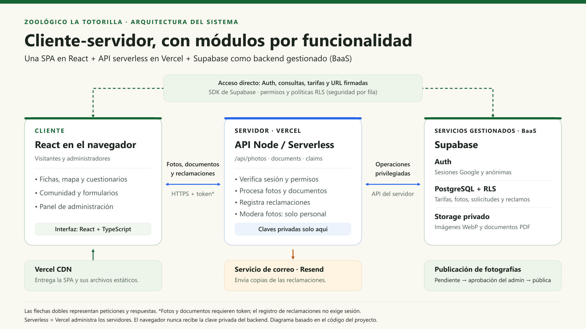
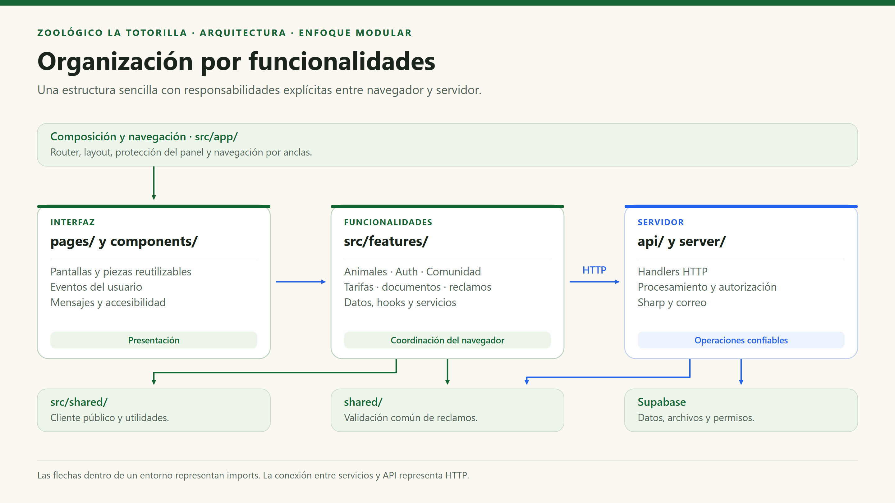

# Parque Zoológico La Totorilla - Plataforma Web

> Plataforma web interactiva del Parque Zoológico La Totorilla (Ayacucho, Perú).
> **Curso:** IS-488 Arquitectura de Software · UNSCH · Semestre 2026-II
> **Sitio desplegado:** [zoologico-totorilla.vercel.app](https://zoologico-totorilla.vercel.app)

---

## Tabla de contenido

1. [Necesidad del negocio](#1-necesidad-del-negocio)
2. [Actores](#2-identificar-actores)
3. [Historias de usuario](#3-identificar-historias-de-usuario)
4. [Requisitos funcionales](#4-identificar-requisitos-funcionales)
5. [Relación entre HU y requisitos funcionales](#5-relación-entre-hu-y-requisitos-funcionales)
6. [Atributos de calidad](#6-identificar-atributos-de-calidad)
7. [Restricciones](#7-identificar-restricciones)
8. [Drivers arquitectónicos](#8-identificar-drivers-arquitectónicos)
9. [Decisiones arquitectónicas (ADR)](#9-decisiones-arquitectónicas-adr)
10. [Estilo arquitectónico](#10-estilo-arquitectónico)
11. [Enfoque arquitectónico: modular por funcionalidades](#11-enfoque-arquitectónico-modular-por-funcionalidades)
12. [Tecnologías y ejecución](#12-tecnologías-y-ejecución)

---

# 1. Necesidad del negocio

El proyecto consiste en desarrollar una plataforma web para el **Parque Zoológico La Totorilla**, ubicado en Ayacucho. El sistema busca digitalizar parte de la experiencia del visitante, permitiendo consultar información del zoológico (horarios, ubicación y tarifas), conocer las especies disponibles, revisar características y contenido educativo de los animales y planificar una visita desde un navegador web.

El sistema dispone además de una sección de **comunidad**, donde los visitantes pueden compartir fotografías de su visita, y de un **panel de administración** para gestionar las tarifas, moderar las fotografías y revisar el catálogo de especies.

La solución es una aplicación web SPA con persistencia centralizada en **Supabase** (PostgreSQL, Auth y Storage). El esquema, los permisos y el despliegue de la API de imágenes se documentan en [BD.md](BD.md).

## Problema y objetivos del negocio

| ID | Objetivo del negocio | Resultado esperado |
|---|---|---|
| OB01 | Digitalizar la información del zoológico (horarios, ubicación, tarifas y fauna). | Visitantes mejor informados antes y durante su visita. |
| OB02 | Facilitar la planificación de la visita mediante información clara y accesible. | Visitantes que llegan al zoológico con la información necesaria. |
| OB03 | Fomentar el aprendizaje sobre las especies mediante contenido educativo interactivo. | Mejor experiencia educativa y recreativa. |
| OB04 | Crear una comunidad de visitantes que comparta fotografías. | Mayor interacción y difusión del zoológico. |
| OB05 | Centralizar la administración de tarifas y contenido. | Gestión más rápida, organizada y controlada por personal autorizado. |
| OB06 | Preparar la plataforma para crecer y compartir datos entre usuarios. | Evolución del almacenamiento local a una base de datos centralizada (Supabase). |

---

# 2. Identificar actores

| ID | Actor | Tipo | ¿Qué necesita realizar? |
|---|---|---|---|
| A01 | Visitante | Humano | Consultar información del zoológico, explorar animales, interactuar con recursos educativos y compartir fotografías. |
| A02 | Administrador | Humano | Gestionar tarifas, moderar fotografías de visitantes y consultar el catálogo de especies. |
| A03 | Supabase | Sistema externo / Plataforma | Proporcionar autenticación, base de datos y almacenamiento centralizado para la aplicación. |

> **Persistencia:** tarifas y solicitudes se almacenan en PostgreSQL; las fotos WebP en Storage privado. Las publicaciones y eliminaciones requieren revisión administrativa. Las credenciales de Supabase Auth se mantienen en `sessionStorage`.

---

# 3. Identificar historias de usuario

> **Como [actor], quiero [acción], para [beneficio].**

| ID | Historia de usuario |
|---|---|
| HU01 | Como visitante, quiero consultar información general del zoológico, para conocer sus horarios, ubicación, tarifas y servicios. |
| HU02 | Como visitante, quiero explorar las especies del zoológico, para conocer sus características, hábitat y estado de conservación. |
| HU03 | Como visitante, quiero consultar la ficha detallada de un animal, para obtener información educativa y datos curiosos sobre la especie. |
| HU04 | Como visitante, quiero interactuar con recursos educativos como sonidos y cuestionarios, para aprender de manera entretenida. |
| HU05 | Como visitante, quiero compartir fotografías de mi visita, para participar en la comunidad del zoológico. |
| HU06 | Como administrador, quiero iniciar sesión en el panel administrativo, para acceder de manera restringida a las funciones de gestión. |
| HU07 | Como administrador, quiero modificar las tarifas, para mantener actualizada la información del zoológico. |
| HU08 | Como administrador, quiero moderar las fotografías publicadas por visitantes, para mantener controlado el contenido de la comunidad. |
| HU09 | Como administrador, quiero consultar el catálogo de animales publicado, para verificar el contenido disponible en la plataforma. |

---

# 4. Identificar requisitos funcionales

| ID | Requisito funcional |
|---|---|
| RF01 | El sistema debe permitir consultar información general del zoológico. |
| RF02 | El sistema debe permitir consultar horarios, ubicación y tarifas. |
| RF03 | El sistema debe permitir mostrar el listado de especies disponibles. |
| RF04 | El sistema debe permitir consultar el detalle de una especie. |
| RF05 | El sistema debe permitir reproducir sonidos asociados a determinadas especies. |
| RF06 | El sistema debe permitir mostrar datos curiosos e información educativa de los animales. |
| RF07 | El sistema debe permitir realizar cuestionarios interactivos relacionados con las especies. |
| RF08 | El sistema debe permitir registrar fotografías de los visitantes en el muro comunitario. |
| RF09 | El sistema debe permitir eliminar fotografías publicadas en el muro comunitario. |
| RF10 | El sistema debe permitir al administrador iniciar sesión. |
| RF11 | El sistema debe restringir el acceso al panel administrativo a usuarios autorizados. |
| RF12 | El sistema debe permitir modificar las tarifas. |
| RF13 | El sistema debe permitir restablecer las tarifas a sus valores base. |
| RF14 | El sistema debe permitir al administrador moderar y eliminar fotografías. |
| RF15 | El sistema debe permitir consultar el catálogo de especies desde el panel administrativo. |
| RF16 | El sistema debe almacenar la información de especies, fotografías, tarifas y usuarios administrativos en una base de datos centralizada cuando se implemente Supabase. |

---

# 5. Relación entre HU y requisitos funcionales

| Historia de usuario | Requisitos funcionales relacionados |
|---|---|
| HU01 Consultar información general | RF01, RF02 |
| HU02 Explorar especies | RF03, RF04 |
| HU03 Consultar ficha de animal | RF04, RF06 |
| HU04 Interactuar con recursos educativos | RF05, RF06, RF07 |
| HU05 Compartir fotografías | RF08 |
| HU06 Iniciar sesión administrativa | RF10, RF11 |
| HU07 Modificar tarifas | RF12, RF13 |
| HU08 Moderar fotografías | RF09, RF14 |
| HU09 Consultar catálogo publicado | RF15 |
| Persistencia centralizada (transversal) | RF16 |

---

# 6. Identificar atributos de calidad

| ID | Atributo de calidad | Escenario de calidad |
|---|---|---|
| AC01 | Rendimiento | Las páginas de inicio, fauna e información deben responder rápidamente incluso cuando varios visitantes consulten el sistema simultáneamente. |
| AC02 | Disponibilidad | La plataforma debe permanecer disponible para permitir consultar información durante el horario de atención. |
| AC03 | Escalabilidad | La arquitectura debe permitir aumentar la cantidad de usuarios y operaciones sin rediseñar completamente la aplicación. |
| AC04 | Seguridad | El acceso al panel administrativo y la modificación de tarifas y contenido deben estar protegidos frente a accesos no autorizados. |
| AC05 | Usabilidad | El visitante debe poder consultar animales e información del zoológico mediante una interfaz sencilla e intuitiva. |
| AC06 | Mantenibilidad | Los cambios en fauna, información, comunidad o administración deben poder realizarse sin afectar innecesariamente otros módulos. |
| AC07 | Compatibilidad | La aplicación debe funcionar correctamente en navegadores web modernos y diferentes tamaños de pantalla. |
| AC08 | Integridad de datos | Las tarifas, fotografías y registros almacenados deben conservar consistencia entre las operaciones realizadas. |

---

# 7. Identificar restricciones

| ID | Restricción | Descripción |
|---|---|---|
| RC01 | Aplicación web | El sistema debe ser accesible mediante un navegador web. |
| RC02 | React + TypeScript | El frontend debe mantenerse desarrollado con React y TypeScript. |
| RC03 | Vite | El proyecto utiliza Vite como herramienta de construcción y desarrollo. |
| RC04 | Git y GitHub | El código fuente debe mantenerse versionado mediante Git y alojado en GitHub. |
| RC05 | Arquitectura por capas | La solución debe organizarse mediante capas de presentación, lógica de negocio y datos. |
| RC06 | Supabase | La solución debe estar preparada para utilizar Supabase como plataforma de persistencia y servicios al escalar. |
| RC07 | Navegadores modernos | La aplicación debe mantener compatibilidad con navegadores web actuales. |
| RC08 | Diseño responsive | La interfaz debe adaptarse a dispositivos móviles, tablets y computadoras. |
| RC09 | Protección administrativa | Las funciones de administración deben estar restringidas a usuarios autorizados. |

---

# 8. Identificar drivers arquitectónicos

Un driver arquitectónico es un requisito, atributo de calidad o restricción que tiene una influencia importante sobre las decisiones arquitectónicas.

| ID | Driver arquitectónico | Origen | ¿Por qué influye en la arquitectura? |
|---|---|---|---|
| DA01 | El sistema debe soportar un crecimiento progresivo de usuarios y operaciones. | AC03 – Escalabilidad | Obliga a considerar una solución de datos centralizada y preparada para crecimiento. |
| DA02 | El sistema debe proteger el panel administrativo y los datos que gestiona. | AC04 – Seguridad | Influye en autenticación, autorización, políticas de acceso y protección de datos. |
| DA03 | Las consultas de información y fauna deben responder rápidamente. | AC01 – Rendimiento | Influye en la estructura de componentes, la carga de datos y la comunicación entre capas. |
| DA04 | Supabase será utilizado como plataforma de datos al escalar. | RC06 – Supabase | Condiciona la capa de datos y el mecanismo de persistencia centralizada. |
| DA05 | Las funciones administrativas deben estar separadas de las funciones públicas. | AC04 / RC09 | Influye en autenticación, autorización y protección de rutas. |
| DA06 | El sistema debe permitir modificar funcionalidades sin afectar innecesariamente otros módulos. | AC06 – Mantenibilidad | Influye en la separación de responsabilidades, la modularidad y las dependencias internas. |
| DA07 | El frontend debe comunicarse con los datos mediante servicios bien definidos. | RC05 – Arquitectura por capas | Permite mantener dependencias controladas entre presentación, negocio y datos. |

## Problema que plantea cada driver y decisión que lo responde

| Driver | Problema que plantea | Decisión que responde |
|---|---|---|
| DA01 – Escalabilidad | Aumentará la cantidad de visitantes en feriados y campañas. | Monolito modular + Supabase (ADR-001, ADR-003). |
| DA02 – Seguridad | Existe un panel administrativo que modifica tarifas y contenido. | Supabase Auth, políticas RLS y rutas protegidas (ADR-005). |
| DA03 – Rendimiento | Muchos visitantes consultarán fauna e información a la vez. | Carga diferida, caché de lectura y recursos estáticos en CDN (ADR-006). |
| DA04 – Supabase | Persistencia centralizada, compartida y protegida por RLS. | Servicios de datos Supabase (ADR-003, ADR-004). |
| DA05 – Separación admin/público | Las funciones de gestión no deben ser accesibles al público. | Autenticación, autorización y rutas protegidas (ADR-005). |
| DA06 – Mantenibilidad | Un cambio en un módulo no debe romper los demás. | Modularidad por funcionalidades y separación de responsabilidades (ADR-001, ADR-002). |
| DA07 – Servicios definidos | La interfaz no debe conocer cómo se guardan los datos. | Casos de uso y puertos (ADR-002, ADR-004). |

---

# 9. Decisiones arquitectónicas (ADR)

Un **ADR (Architecture Decision Record)** documenta las decisiones importantes del diseño de la arquitectura junto con su justificación, las alternativas evaluadas y sus consecuencias.

| ID | Decisión arquitectónica | Driver relacionado | Alternativas consideradas | Justificación | Resultado / Consecuencias |
|---|---|---|---|---|---|
| ADR-001 | **Monolito modular** (una sola aplicación SPA desplegable, dividida en módulos independientes). | DA01 – Escalabilidad; DA06 – Mantenibilidad | Microservicios; aplicación monolítica sin módulos. | El alcance del proyecto no justifica la complejidad operativa de los microservicios, pero sí requiere módulos con responsabilidades separadas. | Módulos de **Fauna, Información, Comunidad, Autenticación y Administración**; un único despliegue. |
| ADR-002 | **Diseño modular por funcionalidades** como enfoque de organización interna. | DA06 – Mantenibilidad; DA07 – Servicios definidos | Página única con lógica concentrada; organización solo por tipo de archivo. | Agrupa datos, servicios y hooks por tema y separa presentación, coordinación y procesamiento confiable. | `src/features/`, `src/pages/`, `src/components/`, `api/`, `server/` y utilidades compartidas. |
| ADR-003 | **Supabase** como plataforma de persistencia (PostgreSQL, Auth y Storage). | DA01 – Escalabilidad; DA04 – Supabase; DA02 – Seguridad | Backend y base autogestionados. | Comparte información y aplica permisos centralizados. | Tablas y bucket privado descritos en BD.md; API Node para sanitizar fotos. |
| ADR-004 | Servicios de acceso a datos separados de los componentes. | DA04 – Supabase; DA07 – Servicios definidos; DA06 – Mantenibilidad | Consultas repartidas por los componentes. | Facilita mantenimiento y pruebas. | Servicios de fotos, solicitudes y tarifas en `src/features/`. |
| ADR-005 | **Autenticación y autorización** con Supabase Auth, RLS y rutas protegidas. | DA02 – Seguridad; DA05 – Separación admin/público | Autorización únicamente visual. | Protege operaciones desde el servidor y la base. | Administradores autorizados explícitamente en `photo_admins`; revisión de publicación y eliminación. |
| ADR-006 | **Estrategia de rendimiento**: carga diferida de rutas (*lazy loading*), caché de consulta para fauna e información y recursos estáticos servidos desde CDN. | DA03 – Rendimiento | Cargar toda la aplicación al inicio; consultar la base de datos en cada visita. | Reduce el tiempo de carga inicial y las consultas repetitivas de información que casi no cambia. | Mejor tiempo de respuesta en Inicio, Fauna e Información; menor carga sobre Supabase. |
| ADR-007 | **Despliegue como aplicación estática en Vercel** con versionamiento en GitHub. | DA01 – Escalabilidad; RC04 – Git y GitHub | Servidor propio; otro proveedor de hosting. | Despliegue continuo desde GitHub, CDN incluido y sin administrar servidores. | Cada cambio en la rama principal puede publicarse automáticamente. |

---

# 10. Estilo arquitectónico

## Estilo seleccionado

**Cliente-servidor, con módulos por funcionalidad y servicios gestionados (BaaS).**

- **Cliente-servidor:** una SPA en el navegador consume las API Node propias y los servicios autorizados de Supabase.
- **Modularidad:** funcionalidades agrupadas en `src/features/`, con páginas, componentes y utilidades compartidas.
- **Serverless:** Vercel ejecuta los handlers de fotos, documentos y reclamaciones.
- **BaaS:** persistencia, autenticación y almacenamiento se delegan a Supabase.

> La SPA y los handlers pertenecen al mismo proyecto de Vercel, pero se ejecutan en entornos distintos. El navegador nunca recibe credenciales privadas.

## Justificación frente a otros estilos

| Estilo | ¿Se selecciona? | Motivo |
|---|---|---|
| Diseño modular por funcionalidades | ✅ Sí | Simplicidad, responsabilidades separadas y evolución gradual. |
| Cliente-servidor con BaaS | ✅ Sí | La SPA utiliza API propias y delega identidad, datos y archivos a Supabase. |
| Microservicios | ❌ No | Complejidad y costo excesivos para el tamaño del proyecto. |
| SOA | ❌ No | No existen múltiples servicios empresariales que orquestar. |
| Event-driven | ❌ No | No hay procesos asíncronos complejos que lo requieran. |
| Funciones serverless | ✅ Complemento | Los handlers Node realizan operaciones sensibles y procesamiento confiable en Vercel. |

## Evolución del estilo

| Etapa | Persistencia | Autenticación | Archivos |
|---|---|---|---|
| Implementación actual | PostgreSQL de Supabase | Supabase Auth | WebP en Storage privado, con revisión |
| Escalamiento | Supabase (PostgreSQL) | Supabase Auth + RLS | Supabase Storage |

## Diagrama del estilo arquitectónico



**Reglas de la arquitectura**

1. Las páginas y componentes delegan la coordinación y el acceso a datos en servicios y hooks.
2. Las funcionalidades reutilizan utilidades comunes sin mezclar responsabilidades ajenas.
3. Las operaciones sensibles verifican identidad, permisos y entradas en el servidor.
4. Las consultas directas a Supabase quedan sujetas a grants y RLS; los secretos se utilizan solo en las API.

---

# 11. Enfoque arquitectónico: modular por funcionalidades

| Elemento | Descripción aplicada al Zoológico La Totorilla |
|---|---|
| Patrón / enfoque arquitectónico | Diseño modular por funcionalidades dentro del sistema cliente-servidor. |
| Objetivo | Localizar cambios y separar responsabilidades entre interfaz, coordinación y operaciones confiables. |
| ¿Qué problema resuelve? | Evita concentrar toda la lógica en las páginas y mezclar credenciales del servidor con código del navegador. |
| Organización | Funcionalidades en `src/features/`, presentación en páginas/componentes y handlers Node en `api/`. |
| Comunicación | El navegador consulta Supabase con permisos/RLS y utiliza las API propias para operaciones sensibles. |
| Beneficios | • Facilita el mantenimiento y las pruebas.<br>• Reutiliza utilidades comunes.<br>• Mantiene explícitas las fronteras de seguridad. |

## Responsabilidades por carpeta

| Carpeta | Responsabilidad | Ejemplo |
|---|---|---|
| `src/pages/`, `src/components/` | Presentación e interacción. | Páginas, formularios y muro de fotografías. |
| `src/features/` | Datos, servicios, validaciones y hooks de cada funcionalidad. | Animales, tarifas, Comunidad, Mesa de Partes y reclamaciones. |
| `src/shared/`, `shared/` | Utilidades comunes y reglas reutilizables según el entorno. | Cliente público Supabase y validación de reclamaciones. |
| `api/`, `server/` | Autorización, procesamiento y coordinación del lado servidor. | Recepción de fotos/documentos y envío de copias de hojas. |
| `supabase/` | Persistencia, permisos e integridad. | Migraciones, políticas RLS y cuotas. |

## Estructura de carpetas actual

La implementación usa una organización modular sencilla: cada funcionalidad
reúne sus datos y servicios, y comparte únicamente las utilidades necesarias.

```text
src/
├── app/                     # Router, layout, protección y navegación
├── components/              # Componentes visuales reutilizables
├── features/                # Datos y lógica agrupados por funcionalidad
│   ├── animals/             # animals.data.ts y consultas de especies
│   ├── auth/                # Sesiones y autorización administrativa
│   ├── claims/              # Reclamaciones y bandeja del personal
│   ├── community/           # Fotos, compresión y moderación
│   ├── requests/            # Mesa de Partes y validación
│   ├── tickets/             # Tarifas de entradas y estacionamiento
│   └── zoo/                 # Mapa, historia y normas de visita
├── pages/                   # Páginas asociadas a las rutas
├── shared/                  # Supabase, datos del sitio y utilidades comunes
├── App.tsx
├── index.css
└── main.tsx
```

Los componentes comunes se ubican únicamente en `components/`. `app/` y `shared/`
no tienen subdivisiones para archivos aislados. Los módulos de `features/` acceden
al cliente común sin depender de los servicios de otra funcionalidad.

> **Acceso a datos:** el cliente Supabase compartido se configura en `src/shared/supabase.ts`; los servicios de cada funcionalidad están en `src/features/`.

## Diagrama del enfoque modular



---

# 12. Tecnologías y ejecución

| Componente | Tecnología |
|---|---|
| Frontend | React 19 + TypeScript |
| Construcción | Vite |
| Estilos | Tailwind CSS |
| Enrutamiento | React Router |
| Persistencia | Supabase PostgreSQL + Storage |
| Persistencia (escalamiento) | Supabase (PostgreSQL, Auth, Storage) |
| Calidad de código | Oxlint |
| Métricas | Vercel Analytics y Speed Insights |
| Despliegue | Vercel |
| Control de versiones | Git + GitHub |

```bash
# Instalar dependencias
npm install

# Entorno de desarrollo
npm run dev

# Verificación de código
npm run lint

# Compilación de producción
npm run build

# Vista previa de la compilación
npm run preview
```
