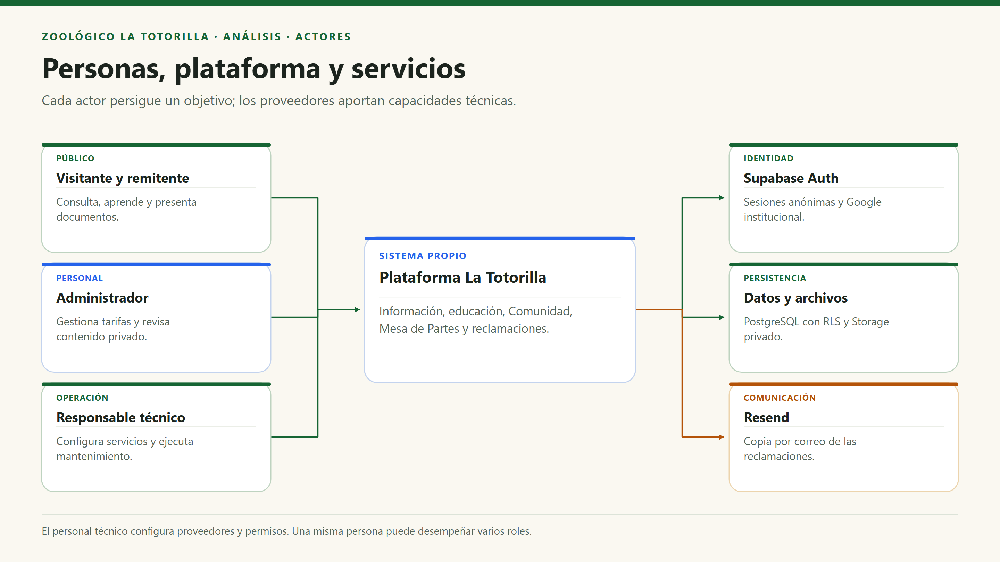

# Actores del sistema

[Índice general](../README.md) · [Siguiente: historias de usuario](02-historias-del-usuario.md)

## 1. Propósito y contexto

La plataforma del Parque Zoológico La Totorilla permite informarse antes y durante la visita, consultar especies y sus recintos, compartir fotografías bajo moderación y presentar documentos o reclamaciones. El análisis diferencia a las **personas que persiguen un objetivo** de los servicios tecnológicos que permiten realizarlo.

## 2. Actores humanos

| ID | Actor | Qué necesita realizar | Identificación / permisos | Evidencia |
|---|---|---|---|---|
| A01 | Visitante o público general | Consultar horarios, tarifas, mapa, fichas, sonidos, datos curiosos y cuestionarios; ver fotos aprobadas. | La consulta pública no exige una cuenta. | `HomePage`, `TicketsPage`, `MapaPage`, `AnimalPage`, `CommunityPage`. |
| A02 | Visitante que comparte fotos | Enviar imágenes y solicitar la eliminación de sus fotos desde su sesión. | La aplicación obtiene una sesión Supabase, anónima si no existe otra. El propietario es `user.id`, no el nombre escrito en el formulario. | `photos.store.ts`, `useVisitorPhotos.ts`, `api/photos.mjs`. |
| A03 | Remitente de Mesa de Partes | Presentar una solicitud con datos de contacto y un PDF opcional; recibir un identificador. | Token de sesión válido; puede ser anónimo. No recibe acceso público al expediente. | `requests.store.ts`, `api/documents.mjs`. |
| A04 | Consumidor o representante | Registrar reclamo/queja, obtener hoja imprimible y, si corresponde, copia por correo. | El registro no exige sesión; requiere campos válidos y conformidad. Un menor puede consignar representante. | `ClaimsPage.tsx`, `shared/claims.mjs`, `api/claims.mjs`. |
| A05 | Personal administrador | Cambiar tarifas, moderar fotos, consultar/eliminar documentos y consultar reclamaciones. | Cuenta institucional no anónima para el panel y membresía explícita en `photo_admins`; controles adicionales en API/RLS. | `auth.context.tsx`, `RequireAdmin.tsx`, `AdminDashboardPage.tsx`. |
| A06 | Responsable técnico del proyecto | Configurar secretos, proveedores y permisos; ejecutar mantenimiento autorizado. | Acceso confiable al hosting/Supabase. No es un rol de autoservicio dentro de la interfaz. | Variables de entorno, migraciones y scripts de `server/`. |

Una misma persona puede actuar como visitante, remitente y consumidor. Estos nombres describen **roles de interacción**, no seis tablas de usuarios ni seis cuentas diferentes.

## 3. Sistemas externos y soporte

| ID | Servicio | Responsabilidad | Relación con el sistema |
|---|---|---|---|
| SE01 | Supabase Auth | Emitir y verificar sesiones; integrar el inicio de sesión con Google. | SDK en navegador y `getUser(token)` en las API protegidas. |
| SE02 | Google | Proveedor de identidad para el acceso institucional. | OAuth coordinado por Supabase Auth. |
| SE03 | Supabase PostgreSQL / Data API | Persistir tarifas, fotos, solicitudes, reclamaciones y membresías con permisos. | Acceso HTTPS mediante SDK y aplicación de RLS para clientes no privilegiados. |
| SE04 | Supabase Storage | Almacenar WebP y PDF en buckets privados. | API del servidor para escribir; URLs firmadas para lectura autorizada. |
| SE05 | Resend | Aceptar el envío de copias de hojas de reclamación. | Integración HTTPS desde `server/claim-mail.mjs`. |
| SE06 | Vercel | Servir la SPA y ejecutar las funciones Node. | Plataforma de despliegue; no es una persona ni un rol de negocio. |

## 4. Diagrama de participación

## 5. Matriz resumida de acceso

| Operación | Público sin sesión | Visitante con sesión | Administrador autorizado |
|---|---|---|---|
| Consultar mapa, fichas y tarifas | Sí | Sí | Sí |
| Ver muro de fotos publicadas | Sí | Sí | Sí |
| Subir fotos / presentar documentos | No, se obtiene sesión antes | Sí, sujeto a validaciones y cuotas | Sí, sujeto a los controles del flujo |
| Aprobar una foto | No | No | Sí, mediante la API |
| Consultar documentos o reclamaciones del personal | No | No | Sí, mediante políticas autorizadas |
| Registrar una reclamación | Sí, si el libro está configurado | Sí | Sí, sin privilegio especial para el alta |
| Darse de alta como administrador | No | No | No existe función de alta en el panel; la gestión es confiable y externa |

**Límite importante:** `authenticated` en Supabase también incluye usuarios anónimos. No equivale al rol de administrador. La autorización depende de la membresía y los controles correspondientes.
