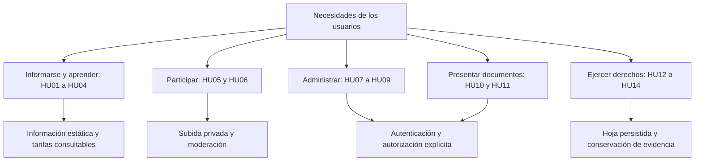

# Historias de usuario

[Índice general](../README.md) · [Actores](01-actores.md) · [Requisitos](03-requisitos-funcionales.md)

## 1. Objetivo

Expresar las necesidades en lenguaje del usuario y conectarlas con comportamientos observables. Las historias no prometen funciones ausentes: «Entradas» informa tarifas, pero no vende boletos; «Comunidad» comparte fotografías, no artículos de texto.

## 2. Historias y criterios de aceptación

| ID | Historia de usuario | Criterio principal de aceptación | Estado en código |
|---|---|---|---|
| HU01 | Como visitante, quiero consultar horarios, ubicación y tarifas para planificar mi visita. | Se muestran datos institucionales, entradas y estacionamiento; ante fallo de consulta de overrides se mantienen tarifas base. | Implementado. |
| HU02 | Como visitante, quiero buscar animales por nombre o recinto para encontrarlos en el zoológico. | El mapa permite búsqueda, filtro de fichas, zoom y localización de recintos con posición conocida. | Implementado; no todos los animales tienen ficha o posición. |
| HU03 | Como visitante, quiero abrir una ficha de especie para aprender sobre ella. | Una ruta válida muestra descripción, hábitat, dieta y datos; un slug inexistente no genera una ficha inventada. | Implementado para vizcacha, alpaca y vicuña. |
| HU04 | Como visitante, quiero escuchar sonidos y usar tarjetas y cuestionarios para aprender de forma interactiva. | El sonido depende de interacción y recurso disponible; las tarjetas giran y el cuestionario da retroalimentación. | Implementado; no guarda progreso en BD. |
| HU05 | Como visitante, quiero enviar fotos de mi visita para participar en la comunidad. | Acepta JPG/PNG/WebP de hasta 10 MiB por original, máximo seis por selección; comprime y deja pendientes de aprobación. | Implementado; requiere Auth y API configurados. |
| HU06 | Como propietario, quiero solicitar la retirada de una foto para controlar su publicación. | La API verifica `owner_id`; registra la solicitud y el personal decide su eliminación. | Implementado; depende de conservar la sesión. |
| HU07 | Como personal autorizado, quiero iniciar sesión con Google para acceder al panel. | Una cuenta institucional no obtiene privilegios solo por su dominio: debe tener membresía en `photo_admins`. | Implementado; depende de OAuth y redirecciones. |
| HU08 | Como administrador, quiero modificar y restablecer tarifas para publicar precios actualizados. | Se guardan overrides autorizados y restablecer elimina esos overrides para recuperar valores base. | Implementado; no hay cobros. |
| HU09 | Como administrador, quiero aprobar/rechazar fotos para evitar publicaciones sin revisión. | Solo una foto `pending` puede aprobarse/rechazarse; se guardan revisor y fecha. | Implementado. |
| HU10 | Como remitente, quiero presentar un documento para que el zoológico lo reciba. | Valida datos, consentimiento y PDF opcional de hasta 3 MiB; devuelve código de registro al finalizar. | Implementado; no confirma aprobación del trámite. |
| HU11 | Como administrador, quiero revisar los documentos recibidos para atenderlos internamente. | Solo personal autorizado consulta datos, obtiene enlaces privados y puede eliminar documentos. | Implementado; no hay un gestor de expedientes completo. |
| HU12 | Como consumidor o representante, quiero registrar una reclamación para ejercer mis derechos. | Verifica datos, representante cuando corresponde y conformidad; emite una hoja con código y fecha. | Implementado; exige configuración legal y de correo. |
| HU13 | Como consumidor, quiero imprimir mi hoja y recibir una copia para conservar evidencia. | Se ofrece impresión/PDF; un fallo de correo no borra la hoja registrada ni afirma entrega efectiva. | Implementado; correo dependiente de Resend. |
| HU14 | Como administrador, quiero consultar reclamaciones para organizar su atención. | La bandeja paginada muestra las hojas solo con permisos adecuados. | Implementado; no envía respuestas al consumidor desde la bandeja. |

## 3. Agrupación por objetivos

## 4. Límites y mejoras futuras

| Tema | Situación actual | Tratamiento correcto |
|---|---|---|
| QR en jaulas | Las rutas de especies permiten ser destino de un QR. No hay generador ni inventario de carteles en la aplicación. | Propuesta operativa; no afirmar que ya está instalado físicamente. |
| Una foto al día por persona | La migración permite 12 reservas/día por identidad. No limita por IP ni identifica personas de forma inequívoca. | Requiere otro requisito y otra implementación. |
| Gestión de especies desde el panel | El contenido se mantiene en archivos TypeScript y recursos de `public/`. | La consulta del catálogo no implica CRUD de especies en BD. |
| Respuesta a reclamos | La bandeja permite consulta; existen campos de respuesta en la tabla. | Tener columnas no equivale a disponer de un flujo completo de atención. |

## 5. Evidencia y validación

Los criterios se verifican recorriendo las páginas y contrastando las API y políticas, no solo observando botones. Para HU09, por ejemplo, se necesita probar que un visitante no puede aprobar mediante una llamada HTTP directa. La matriz de trazabilidad siguiente relaciona estas historias con requisitos verificables.
