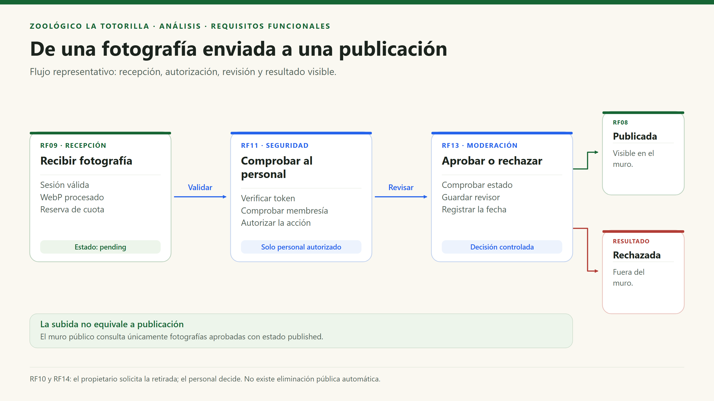

# Requisitos funcionales y trazabilidad

[Índice general](../README.md) · [Historias](02-historias-del-usuario.md) · [Calidad](04-atributos-de-calidad.md)

## 1. Alcance de la especificación

Los requisitos describen el alcance funcional del sistema y distinguen los comportamientos observados en el repositorio de los pendientes de completar. «Implementado» significa que hay código, no que se haya certificado la operación en producción. Los flujos externos necesitan configuración y verificación de extremo a extremo. RF21 incorpora el acceso por QR para cada especie; su cobertura completa y señalización física están pendientes de verificar.

## 2. Catálogo de requisitos

| ID | Requisito funcional | Entrada / resultado verificable | Evidencia principal |
|---|---|---|---|
| RF01 | El sistema debe mostrar información institucional y de visita. | Horarios, dirección y contenido de bienvenida visibles. | `src/shared/site.ts`, `HomePage.tsx`. |
| RF02 | El sistema debe permitir consultar las tarifas de entradas y estacionamiento. | Overrides de BD o valores base, sin proceso de pago. | `tickets.config.ts`, `prices.store.ts`. |
| RF03 | El sistema debe mostrar el croquis interactivo y permitir recorrerlo. | Zoom entre 100 % y 300 %, ajuste, descarga y diálogo ampliado. | `MapaPage.tsx`. |
| RF04 | El sistema debe permitir buscar animales y relacionarlos con sus recintos. | Búsqueda normalizada por nombre/número y filtro de ficha educativa. | `map-animals.ts`, `map.data.ts`. |
| RF05 | El sistema debe presentar las fichas de las especies existentes. | Contenido obtenido por slug; manejo de ruta inválida. | `AnimalPage.tsx`, `animals.service.ts`. |
| RF06 | El sistema debe permitir reproducir los recursos de audio disponibles. | Reproducción, pausa y control de error del recurso. | `AnimalSound.tsx`. |
| RF07 | El sistema debe mostrar datos curiosos y ofrecer cuestionarios interactivos. | Giro de tarjetas y retroalimentación de respuestas. | `FlipFact.tsx`, `Quiz.tsx`. |
| RF08 | El sistema debe listar únicamente fotografías publicadas en el muro. | Consulta con `status = published`; enlaces firmados. | `photos.store.ts`, políticas SQL. |
| RF09 | El sistema debe recibir fotografías válidas de usuarios con una sesión válida. | Original permitido, WebP procesado y registro `pending`. | `image.ts`, `api/photos.mjs`. |
| RF10 | El sistema debe permitir al propietario solicitar la eliminación de una fotografía propia. | Validación de propietario y marca `deletion_requested`. | `PATCH /api/photos`, acción `request-delete`. |
| RF11 | El sistema debe autenticar al personal y verificar su autorización para acceder al panel administrativo. | Google OAuth, filtro institucional y membresía explícita. | `auth.context.tsx`, `RequireAdmin.tsx`. |
| RF12 | El sistema debe permitir al personal autorizado modificar o restablecer las tarifas. | Upsert/delete sobre IDs permitidos con RLS. | `prices.store.ts`, `tariff_overrides`. |
| RF13 | El sistema debe permitir al personal autorizado aprobar o rechazar fotografías pendientes. | Cambio de estado con `reviewed_by` y `reviewed_at`. | `PATCH /api/photos`, acciones `approve`, `reject`. |
| RF14 | El sistema debe permitir al personal autorizado resolver las solicitudes de eliminación de fotografías. | Rechazar solicitud o eliminar objeto y registro de forma controlada. | Acciones `reject-delete`, `approve-delete`. |
| RF15 | El sistema debe registrar las presentaciones realizadas a través de Mesa de Partes. | Datos válidos, consentimiento, PDF opcional y código. | `MesaDePartesPage.tsx`, `api/documents.mjs`. |
| RF16 | El sistema debe permitir al personal autorizado consultar y descargar documentos. | Lectura autorizada y URL de adjunto con vigencia de 60 segundos. | `requests.store.ts`, RLS de Storage. |
| RF17 | El sistema debe permitir al personal autorizado eliminar documentos. | Eliminación del adjunto antes de borrar el registro. | `DELETE /api/documents`. |
| RF18 | El sistema debe registrar reclamos y quejas sin exigir una cuenta. | Validación compartida y alta idempotente de una hoja. | `shared/claims.mjs`, `api/claims.mjs`. |
| RF19 | El sistema debe permitir imprimir la hoja de reclamación y solicitar su copia por correo. | Comprobante imprimible y estado de aceptación del correo. | `ClaimsPage.css`, `claim-mail.mjs`. |
| RF20 | El sistema debe permitir al personal autorizado consultar reclamaciones. | Bandeja paginada de 50 hojas con datos protegidos. | `ClaimsInbox.tsx`, `claims.service.ts`. |
| RF21 | El sistema debe contar con un código QR para cada especie del zoológico, ubicado en su señalización, que permita a los visitantes acceder directamente a la infografía del animal desde su teléfono móvil. | Al escanear el QR se abre la infografía pública de la especie correcta, sin iniciar sesión ni buscarla en el catálogo. Se verifica la existencia y correspondencia del QR, la señalización y la infografía para cada especie. | Base existente: rutas `/fauna/:slug` en `src/app/router.tsx` y `AnimalPage.tsx`. Pendiente: completar infografías, asociar/generar los QR y verificar su colocación para todas las especies. |

## 3. Relación historias–requisitos

| Historia | Requisitos relacionados | Validación principal |
|---|---|---|
| HU01 | RF01, RF02 | Consulta pública y recuperación de tarifas base. |
| HU02 | RF03, RF04 | Búsqueda, zoom y localización. |
| HU03 | RF05 | Ruta de especie válida e inválida. |
| HU04 | RF06, RF07 | Interacciones de audio, tarjetas y quiz. |
| HU05 | RF09 | Validación de archivo, sesión y estado pendiente. |
| HU06 | RF10 | Rechazo de solicitudes para fotos ajenas. |
| HU07 | RF11 | Separar login exitoso de autorización administrativa. |
| HU08 | RF02, RF12 | Persistencia y restablecimiento de overrides. |
| HU09 | RF08, RF13, RF14 | La moderación cambia qué ve el público. |
| HU10 | RF15 | Alta con/sin PDF, validación y código. |
| HU11 | RF16, RF17 | Lectura privada y borrado autorizado. |
| HU12 | RF18 | Validación, idempotencia y campos de representante. |
| HU13 | RF19 | Impresión y degradación controlada del correo. |
| HU14 | RF20 | Privacidad y paginación de la bandeja. |
| HU15 | RF05, RF21 | Escanear el QR de cada especie y comprobar que abre directamente su infografía correspondiente en un navegador móvil, sin autenticación. |

## 4. Flujo funcional representativo

## 5. Reglas que condicionan los requisitos

| Regla | Aplicación concreta |
|---|---|
| El nombre del autor no prueba identidad. | El servidor utiliza el UUID obtenido del token verificado. |
| Una foto enviada no se publica automáticamente. | `uploading → pending → published/rejected`. |
| La validación del navegador no es una barrera de seguridad. | El servidor vuelve a validar y procesar; la BD aplica restricciones. |
| Reintentar un reclamo no debe duplicar la hoja. | Clave UUID única y comparación del hash de los datos normalizados. |
| No confirmar algo que no se terminó. | El alta de documentos con adjunto finaliza después de Storage; correo pendiente no equivale a hoja inexistente. |

## 6. Fuera del alcance implementado

No existen compras/reservas, cobros, emisión de boletos, CRUD de especies en BD, expedientes con estados de atención completos ni historial persistido de quizzes. Se deben tratar como nuevas funcionalidades y no deducirlas del nombre de una página o de una columna de BD.

**Acceso por QR incluido en el alcance requerido:** RF21 exige un QR y una infografía para cada especie. Las rutas públicas existentes sirven como base, pero no acreditan cobertura completa ni instalación de carteles. No se exige desarrollar un generador de QR dentro de la aplicación: los códigos pueden producirse con una herramienta externa siempre que apunten a las URLs definitivas de las infografías y se comprueben individualmente.
