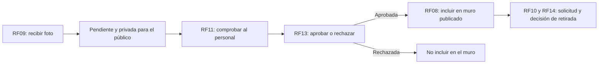

# Requisitos funcionales y trazabilidad

[Índice general](../README.md) · [Historias](02-historias-del-usuario.md) · [Calidad](04-atributos-de-calidad.md)

## 1. Alcance de la especificación

Los requisitos describen el alcance funcional observado en el repositorio. «Implementado» significa que hay código, no que se haya certificado la operación en producción. Los flujos externos necesitan configuración y verificación de extremo a extremo.

## 2. Catálogo de requisitos

| ID | Requisito funcional | Entrada / resultado verificable | Evidencia principal |
|---|---|---|---|
| RF01 | Mostrar información institucional y de visita. | Horarios, dirección y contenido de bienvenida visibles. | `src/shared/site.ts`, `HomePage.tsx`. |
| RF02 | Consultar tarifas de entradas y estacionamiento. | Overrides de BD o valores base, sin proceso de pago. | `tickets.config.ts`, `prices.store.ts`. |
| RF03 | Mostrar y recorrer el croquis interactivo. | Zoom entre 100 % y 300 %, ajuste, descarga y diálogo ampliado. | `MapaPage.tsx`. |
| RF04 | Buscar animales y relacionarlos con recintos. | Búsqueda normalizada por nombre/número y filtro de ficha educativa. | `map-animals.ts`, `map.data.ts`. |
| RF05 | Presentar fichas de especies existentes. | Contenido obtenido por slug; manejo de ruta inválida. | `AnimalPage.tsx`, `animals.service.ts`. |
| RF06 | Reproducir recursos de audio disponibles. | Reproducción, pausa y control de error del recurso. | `AnimalSound.tsx`. |
| RF07 | Mostrar datos curiosos y cuestionarios. | Giro de tarjetas y retroalimentación de respuestas. | `FlipFact.tsx`, `Quiz.tsx`. |
| RF08 | Listar únicamente fotografías publicadas en el muro. | Consulta con `status = published`; enlaces firmados. | `photos.store.ts`, políticas SQL. |
| RF09 | Recibir fotografías válidas bajo sesión. | Original permitido, WebP procesado y registro `pending`. | `image.ts`, `api/photos.mjs`. |
| RF10 | Solicitar la eliminación de una fotografía propia. | Validación de propietario y marca `deletion_requested`. | `PATCH /api/photos`, acción `request-delete`. |
| RF11 | Autenticar y autorizar al personal. | Google OAuth, filtro institucional y membresía explícita. | `auth.context.tsx`, `RequireAdmin.tsx`. |
| RF12 | Modificar o restablecer tarifas autorizadas. | Upsert/delete sobre IDs permitidos con RLS. | `prices.store.ts`, `tariff_overrides`. |
| RF13 | Aprobar o rechazar fotos pendientes. | Cambio de estado con `reviewed_by` y `reviewed_at`. | `PATCH /api/photos`, acciones `approve`, `reject`. |
| RF14 | Resolver solicitudes de eliminación de fotos. | Rechazar solicitud o eliminar objeto y registro de forma controlada. | Acciones `reject-delete`, `approve-delete`. |
| RF15 | Registrar presentaciones de Mesa de Partes. | Datos válidos, consentimiento, PDF opcional y código. | `MesaDePartesPage.tsx`, `api/documents.mjs`. |
| RF16 | Permitir al personal consultar y descargar documentos. | Lectura autorizada y URL de adjunto con vigencia de 60 segundos. | `requests.store.ts`, RLS de Storage. |
| RF17 | Permitir al personal eliminar documentos. | Eliminación del adjunto antes de borrar el registro. | `DELETE /api/documents`. |
| RF18 | Registrar reclamos y quejas sin exigir cuenta. | Validación compartida y alta idempotente de una hoja. | `shared/claims.mjs`, `api/claims.mjs`. |
| RF19 | Permitir imprimir la hoja y solicitar su copia por correo. | Comprobante imprimible y estado de aceptación del correo. | `ClaimsPage.css`, `claim-mail.mjs`. |
| RF20 | Permitir al personal consultar reclamaciones. | Bandeja paginada de 50 hojas con datos protegidos. | `ClaimsInbox.tsx`, `claims.service.ts`. |

## 3. Relación historias–requisitos

| Historia | Requisitos relacionados | Validación principal |
|---|---|---|
| HU01 | RF01, RF02 | Consulta pública y recuperación de tarifas base. |
| HU02 | RF03, RF04 | Búsqueda, zoom y localización. |
| HU03 | RF05 | Ruta de especie válida e inválida. |
| HU04 | RF06, RF07 | Interacciones de audio, tarjetas y quiz. |
| HU05 | RF09 | Validación de archivo, sesión y estado pendiente. |
| HU06 | RF10 | Rechazo de solicitudes para fotos ajenas. |
| HU07 | RF11 | Separar login exitoso de autorización administrativa. |
| HU08 | RF02, RF12 | Persistencia y restablecimiento de overrides. |
| HU09 | RF08, RF13, RF14 | La moderación cambia qué ve el público. |
| HU10 | RF15 | Alta con/sin PDF, validación y código. |
| HU11 | RF16, RF17 | Lectura privada y borrado autorizado. |
| HU12 | RF18 | Validación, idempotencia y campos de representante. |
| HU13 | RF19 | Impresión y degradación controlada del correo. |
| HU14 | RF20 | Privacidad y paginación de la bandeja. |

## 4. Flujo funcional representativo

## 5. Reglas que condicionan los requisitos

| Regla | Aplicación concreta |
|---|---|
| El nombre del autor no prueba identidad. | El servidor utiliza el UUID obtenido del token verificado. |
| Una foto enviada no se publica automáticamente. | `uploading → pending → published/rejected`. |
| La validación del navegador no es una barrera de seguridad. | El servidor vuelve a validar y procesar; la BD aplica restricciones. |
| Reintentar un reclamo no debe duplicar la hoja. | Clave UUID única y comparación del hash de los datos normalizados. |
| No confirmar algo que no se terminó. | El alta de documentos con adjunto finaliza después de Storage; correo pendiente no equivale a hoja inexistente. |

## 6. Fuera del alcance implementado

No existen compras/reservas, cobros, emisión de boletos, CRUD de especies en BD, expedientes con estados de atención completos, historial persistido de quizzes ni generador de QR. Se deben tratar como nuevas funcionalidades y no deducirlas del nombre de una página o de una columna de BD.
