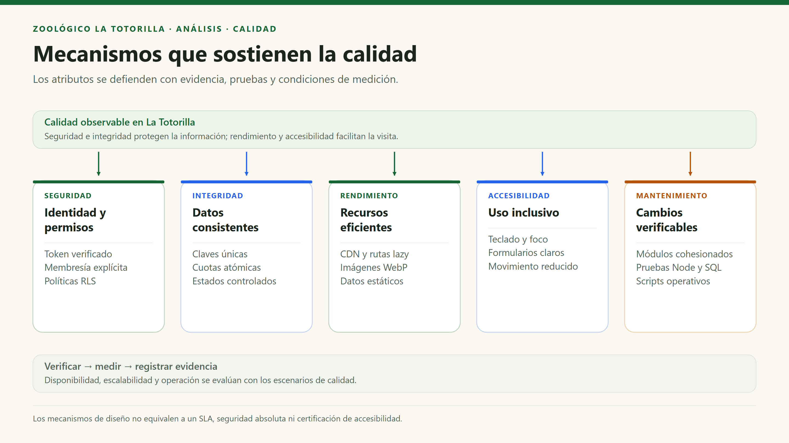

# Atributos de calidad

[Índice general](../README.md) · [Escenarios medibles](08-escenarios-atributos-calidad.md)

## 1. Propósito

Los atributos de calidad describen **cómo debe funcionar** el sistema, no nuevas funciones de negocio. Deben conectarse con decisiones técnicas, riesgos y verificaciones. Su presencia en el diseño no certifica por sí sola que se cumplan bajo cualquier carga.

## 2. Catálogo y evidencia

| ID | Atributo | Necesidad del zoológico | Mecanismos observables | Límites y verificación |
|---|---|---|---|---|
| AC01 | Rendimiento | Consultar especies, mapa y tarifas desde un móvil durante la visita. | Rutas lazy, archivos estáticos, carga diferida de imágenes, WebP de fotos, estado/caché local de tarifas. | No hay Redis ni SLA demostrado; medir red, tamaño de recursos y tiempos reales. |
| AC02 | Disponibilidad y resiliencia | Seguir informando aunque falle un servicio externo. | Catálogo/mapa estáticos y tarifas base; errores controlados de API; hoja de reclamación no se pierde por fallo de correo. | Subidas y consultas protegidas dependen de servicios remotos. No es una PWA offline. |
| AC03 | Seguridad y privacidad | Evitar acceso a documentos, reclamos y decisiones administrativas de terceros. | Token verificado en API, membresía, RLS, grants mínimos, buckets privados, validación de imágenes y secretos de servidor. | La clave privilegiada omite RLS: cada API debe comprobar permisos; una ruta protegida visual no basta. |
| AC04 | Mantenibilidad | Cambiar una funcionalidad sin reorganizar toda la aplicación. | `features/` por tema, utilidades comunes, funciones de validación y servicios separados de páginas. | Hay acoplamiento a React/Supabase y duplicación de algunas validaciones; no afirmar independencia tecnológica total. |
| AC05 | Escalabilidad y eficiencia de coste | Atender aumentos de visitas sin administrar una infraestructura compleja. | CDN, funciones bajo demanda y servicios gestionados; límites de archivos y cuotas por identidad. | Los planes, cold starts y límites de proveedores siguen existiendo. Requiere prueba de carga antes de prometer cifras. |
| AC06 | Integridad y consistencia | Evitar publicaciones indebidas, duplicación de hojas y reservas concurrentes sin control. | Restricciones SQL, clave única, hash, contadores atómicos y actualizaciones condicionales. | PostgreSQL y Storage no comparten una transacción distribuida; pueden quedar operaciones incompletas. |
| AC07 | Usabilidad y accesibilidad | Poder usar formularios, mapa y recursos educativos desde distintos dispositivos y con teclado. | Tailwind responsive, semántica, foco visible, mensajes de error, `aria-*`, diálogo nativo y movimiento reducido. | No equivale a una certificación WCAG. Revisar teclado, zoom, lector de pantalla y contraste. |
| AC08 | Verificabilidad y operación | Diagnosticar errores sin exponer secretos y detectar regresiones. | Tests Node, pruebas SQL con rollback, estados/códigos HTTP y scripts de mantenimiento. | No hay una suite E2E completa ni cron configurado en `vercel.json`; ejecutar y registrar la evidencia. |

## 3. Priorización razonada

| Prioridad | Atributos | Por qué |
|---|---|---|
| Alta | AC03, AC06 | Manejo de datos personales, permisos y evidencia de reclamaciones. Un fallo tiene consecuencias mayores que una demora visual. |
| Alta | AC07 | El producto se usa en móviles y por público diverso. La información debe ser alcanzable. |
| Media-alta | AC01, AC02 | La consulta durante la visita debe ser rápida y tolerar fallos parciales. |
| Media | AC04, AC05, AC08 | Permiten evolucionar y operar el proyecto con recursos limitados. La prioridad aumenta al entrar en operación institucional. |

La priorización es una propuesta técnica, no una aprobación formal del negocio.

## 4. Relación entre mecanismos y calidad

## 5. Compromisos de diseño

| Decisión | Atributo favorecido | Coste o riesgo introducido |
|---|---|---|
| Usar Supabase desde el navegador con RLS. | Menos backend y menor complejidad. | Hay que revisar todas las políticas; la autorización no puede quedar en React. |
| Comprimir antes y después del envío. | Transferencia reducida y validación real del servidor. | CPU del dispositivo y de la función; algunos archivos se rechazan. |
| Mantener fauna estática. | Disponibilidad y simplicidad. | Editar contenido exige commit y despliegue. |
| Guardar Auth en `sessionStorage`. | Sesión limitada al contexto del navegador. | Se puede perder la identidad anónima; no garantiza cuota por persona. |
| Mantener scripts operativos explícitos. | Simplicidad y control. | Sin programación externa no se ejecutan automáticamente. |

Las medidas propuestas y sus condiciones están en los escenarios de calidad. No se han inventado porcentajes de disponibilidad ni resultados de concurrencia como hechos del sistema.
