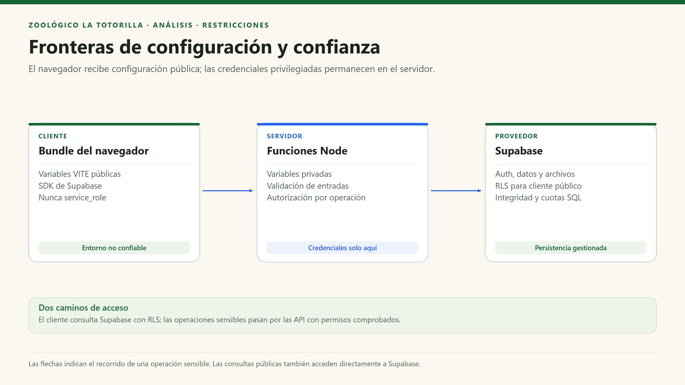

# Restricciones del sistema

[Índice general](../README.md) · [Drivers](06-driver-arquitectonicos.md)

## 1. Qué se considera una restricción

Una restricción limita las alternativas de diseño: una tecnología existente, un requisito de seguridad o una condición de operación. Las restricciones observadas se distinguen de sugerencias de mejora. No se asume una infraestructura o proveedor que no aparezca en el código.

## 2. Restricciones técnicas y operativas

| ID | Restricción | Evidencia / condición | Consecuencia arquitectónica |
|---|---|---|---|
| RC01 | Aplicación web React + TypeScript. | `src/main.tsx`, componentes funcionales y dependencias. | Interfaz ejecutada en navegador y estado gestionado con hooks. |
| RC02 | Construcción con Vite y estilos Tailwind CSS v4. | `vite.config.ts`, `src/index.css`, dependencias. | Recursos estáticos compilados; no hay renderizado de páginas por Next.js. |
| RC03 | Despliegue actual preparado para Vercel. | Handlers `api/*.mjs` y rewrites en `vercel.json`. | La SPA y los handlers tienen entornos de ejecución distintos. Los scripts Wrangler de `package.json` no demuestran un despliegue Cloudflare funcional. |
| RC04 | Supabase como proveedor de Auth, datos y archivos. | SDK compartido, consultas y migraciones. | Autorización mediante grants/RLS y SDK sobre HTTPS. |
| RC05 | Claves privilegiadas solo en servidor. | `SUPABASE_SERVICE_ROLE_KEY` en handlers; frontend usa clave pública. | Ningún secreto puede llevar prefijo `VITE_` ni incluirse en el bundle. |
| RC06 | Acceso administrativo institucional y explícito. | Filtro de dominio y `photo_admins`. | No hay alta automática por correo ni rol editable desde el navegador. |
| RC07 | Solo fotos raster permitidas en Comunidad. | JPG/PNG/WebP; 10 MiB original, 40 MP, seis por selección; archivo final hasta 300 KiB. | Validación y conversión en cliente más recodificación con Sharp en servidor. |
| RC08 | Adjuntos de Mesa de Partes limitados a PDF. | Un PDF opcional de hasta 3 MiB, validado en cliente y servidor. | Bucket privado separado y control de acceso del personal. |
| RC09 | Persistencia histórica compatible. | Nombre `discount_requests`, campo `createdAt` y servicios existentes. | No renombrar tablas/campos sin migración y actualización de consumidores. |
| RC10 | Libro condicionado a configuración legal y correo. | `settings()` en `api/claims.mjs`. | Si no hay configuración válida, el endpoint informa no disponibilidad y no simula un registro. |
| RC11 | Recursos educativos estáticos. | `animals.data.ts`, mapa y archivos de `public/`. | No existe CMS de especies ni progreso educativo persistido. |
| RC12 | Operaciones accesibles y responsive. | Diseño Tailwind, foco y movimiento reducido. | Mantener teclado y semántica al modificar controles o formularios. |

## 3. Límites numéricos implementados

| Operación | Límite observado | Dónde se aplica |
|---|---|---|
| Original de fotografía | 10 × 1024 × 1024 bytes; la interfaz lo llama 10 MB. | `fileToCompressedWebP`. |
| Imagen decodificada | 40 millones de píxeles. | Conversión del cliente y Sharp. |
| WebP enviado / almacenado | 300 × 1024 bytes. | Navegador, API y bucket. |
| PDF | 3 × 1024 × 1024 bytes. | Formulario, API y bucket. |
| Reservas de fotos | 12 por identidad/día de Lima. | Trigger SQL; no por IP ni persona. |
| Reservas de documentos | 10 por identidad/día de Lima. | Trigger SQL. |
| Cuerpo de reclamación | 64 KiB. | `api/claims.mjs`. |
| Páginas de fotos / reclamaciones | 100 fotos / 50 hojas. | Servicios de consulta del navegador. |

## 4. Fronteras que no deben confundirse

La `service_role` no debe enviarse al navegador para «arreglar» un error de permisos. La configuración local tampoco se transfiere automáticamente a Vercel: las variables deben existir en el entorno del despliegue activo.

## 5. Condiciones pendientes de aprobación o despliegue

| Condición | Estado documental |
|---|---|
| Dominio institucional definitivo y redirecciones OAuth. | Deben ser confirmados por el responsable; el valor por defecto del código es `unsch.edu.pe`. |
| Política legal de conservación y atención de reclamos. | La aplicación no acredita por sí sola cumplimiento legal ni respuesta dentro del plazo. |
| Planes, presupuesto, SLA y carga esperada. | No hay cifras de contratación demostradas por el repositorio. |
| Programación de mantenimiento y monitoreo. | Existen scripts, pero no una garantía de ejecución periódica. |
