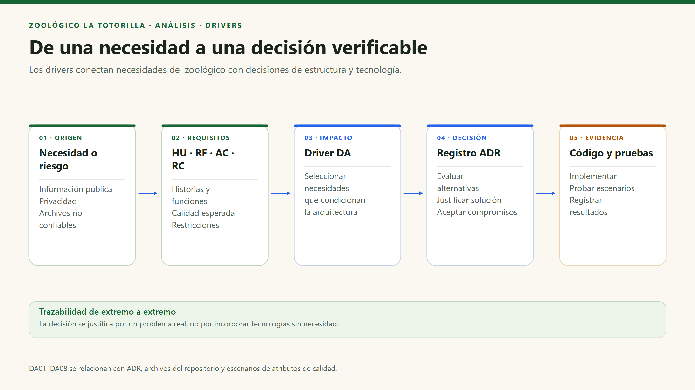

# Drivers arquitectónicos

[Índice general](../README.md) · [Decisiones](07-decisiones-arquitectonicas.md)

## 1. Definición

Un driver es una necesidad con suficiente impacto para condicionar la estructura o las tecnologías del sistema. No es una lista de librerías: conecta requisitos y riesgos con decisiones justificables.

## 2. Drivers identificados

| ID | Driver | Origen | Impacto en la arquitectura | Respuesta observable |
|---|---|---|---|---|
| DA01 | Acceso público rápido a información educativa y de visita. | HU01–HU04; AC01, AC02; RC11. | Evitar depender de una consulta remota para cada ficha o recinto. | Datos estáticos, CDN y rutas lazy. |
| DA02 | Proteger datos personales y operaciones del personal. | HU07, HU11, HU14; AC03; RC05, RC06. | Definir fronteras de confianza y autorización más allá de React. | Supabase Auth, membresía, RLS y verificación en API. |
| DA03 | Recibir archivos no confiables sin publicarlos automáticamente. | HU05, HU09, HU10; AC03, AC06; RC07, RC08. | Procesamiento del lado servidor, almacenamiento privado y estados de revisión. | Sharp, buckets separados y flujo `uploading/pending/published`. |
| DA04 | Mantener la evidencia de reclamaciones y tolerar reintentos. | HU12, HU13; AC06; RC10. | Registro idempotente, datos de proveedor congelados en la hoja y correo desacoplado del éxito de persistencia. | UUID único, hash y estados del correo. |
| DA05 | Evolucionar funcionalidades con una estructura comprensible. | AC04; módulos de mapa, comunidad, documentos y reclamaciones. | Organizar por responsabilidad, no multiplicar capas vacías. | `features/`, componentes comunes y API específicas. |
| DA06 | Reducir operación y coste de infraestructura. | AC05; RC01–RC04. | Delegar hosting, identidad y almacenamiento; no administrar servidores completos. | Vercel y Supabase gestionados. |
| DA07 | Comunicar errores y recuperar fallos parciales. | AC02, AC08; subidas y correo externos. | No confundir un fallo de correo con un registro inexistente; prever mantenimiento de reservas. | Códigos HTTP, scripts de limpieza/reintento y claves de idempotencia. |
| DA08 | Uso desde móviles, acceso por QR a las infografías y teclado. | HU02–HU04, HU15; RF21; AC07. | Rutas públicas estables por especie, controles accesibles y visualización responsive. | React Router, fichas públicas, mapa desplazable, foco y movimiento reducido; cobertura de QR por especie pendiente. |

## 3. De la necesidad a la decisión

## 4. Matriz de trazabilidad arquitectónica

| Driver | ADR relacionados | Evidencia principal | Qué debe verificarse |
|---|---|---|---|
| DA01 | ADR-001, ADR-005 | Router, datos locales, compresión y configuración Vite. | Que la consulta pública no requiera APIs privadas ni descargue todas las rutas al inicio. |
| DA02 | ADR-003, ADR-004 | Contexto Auth, handlers y migraciones. | Que una sesión anónima no permita autoalta, consulta privada ni aprobación de fotos. |
| DA03 | ADR-004, ADR-006 | `image.ts`, `photo-image.mjs`, API y buckets. | Rechazo de archivos falsificados y ausencia de fotos pendientes en el muro. |
| DA04 | ADR-007 | `api/claims.mjs`, tabla y `claim-mail.mjs`. | Reintento igual recupera hoja; diferente devuelve conflicto; fallo de correo no borra hoja. |
| DA05 | ADR-002 | Servicios por tema y `shared/supabase.ts`. | Cambios localizados y ausencia de dependencias innecesarias entre funcionalidades. |
| DA06 | ADR-001, ADR-003 | `vercel.json`, SDK y endpoints Node. | Variables correctas por entorno y funciones operativas; no asumir recursos ilimitados. |
| DA07 | ADR-007, ADR-008 | Scripts de `server/` y respuestas de API. | Recuperación verificable sin exponer secretos ni borrar evidencia válida. |
| DA08 | ADR-005 | Componentes, rutas públicas, estilos y recursos multimedia. | Revisión con teclado y móviles; para HU15/RF21, escanear cada QR y verificar su infografía y señalización antes de darlo por cumplido. |

## 5. Priorización y exclusiones

DA02–DA04 tienen prioridad por confidencialidad e integridad. DA01 y DA08 aseguran utilidad para el visitante. DA05–DA07 permiten operar y mantener el sistema con recursos razonables.

El volumen real de usuarios no está medido en el código. Por tanto, «millones de usuarios», «tiempo real», «microservicios necesarios» o «alta disponibilidad garantizada» no se incorporan como drivers demostrados. Si cambian las necesidades, las decisiones deben reevaluarse con datos.
