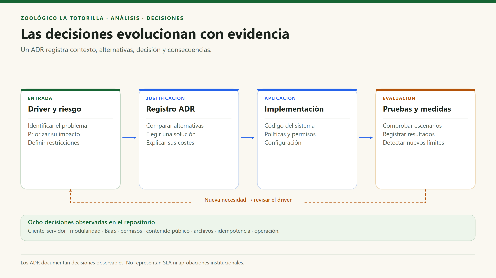

# Decisiones arquitectónicas — ADR

[Índice general](../README.md) · [Drivers](06-driver-arquitectonicos.md) · [Arquitectura global](../02-arquitectura-software/arquitectura-inicial.md)

## 1. Alcance de estos registros

Estos ADR documentan retrospectivamente decisiones observables y sus compromisos. «Adoptada» significa que la implementación sigue esa dirección; no implica acta de aprobación institucional, SLA o ausencia de deuda técnica.

## 2. Resumen comparativo

| ID | Decisión | Drivers | Alternativas consideradas para justificarla | Resultado / consecuencia |
|---|---|---|---|---|
| ADR-001 | Cliente-servidor con SPA, API serverless y BaaS. | DA01, DA06. | Servidor completo autogestionado, sitio solo estático, microservicios. | Interfaz en navegador; operaciones privilegiadas en Node; identidad/datos/archivos en Supabase. |
| ADR-002 | Diseño modular por funcionalidades. | DA05. | Una única página con toda la lógica; organización exclusivamente por tipo de archivo. | Servicios y hooks por tema; se acepta dependencia directa de SDK/React donde simplifica. |
| ADR-003 | Supabase con acceso directo autorizado y API privilegiadas. | DA02, DA06. | Pasar toda lectura por un backend propio; exponer una clave privilegiada al cliente. | Las consultas y tarifas usan RLS; archivos y reclamaciones usan handlers con secretos. |
| ADR-004 | Autorización explícita y defensa en profundidad. | DA02, DA03. | Confiar solo en el dominio del correo o en ocultar botones. | Membresía, API, grants y RLS cooperan; el alta del personal es confiable y externa. |
| ADR-005 | Contenido educativo estático, carga diferida y UI accesible. | DA01, DA08. | CMS obligatorio para todo; cargar todas las páginas al inicio. | Edición por commit; menos dependencias remotas y recursos diferidos. |
| ADR-006 | Archivos privados, validados y publicados mediante revisión. | DA03. | Bucket público y publicación inmediata; confiar en extensión/MIME. | WebP recodificado, PDF limitado, estados y URLs firmadas. |
| ADR-007 | Hoja de reclamación idempotente y correo con fallo independiente. | DA04, DA07. | Repetir altas en cada reintento; eliminar hoja si falla el correo. | UUID único + hash; conservar hoja y marcar correo pendiente. |
| ADR-008 | Pruebas y mantenimiento explícito sin plataforma adicional. | DA05, DA07. | Introducir colas, workers y cron sin necesidad comprobada. | Tests Node/SQL y scripts manuales; la periodicidad operativa debe configurarse aparte. |

## 3. ADR-001 — Cliente-servidor con servicios gestionados

**Estado:** adoptada. **Contexto:** la plataforma combina información pública, operaciones de usuarios y datos privados del personal. Un sitio exclusivamente estático no puede proteger secretos ni recodificar archivos en un entorno confiable.

**Decisión:** React se entrega como SPA; Vercel ejecuta tres handlers Node; Supabase provee Auth, Data API/PostgreSQL y Storage. La aplicación se mantiene como proyecto modular, no como una red de microservicios de negocio.

**Beneficio:** poca administración de infraestructura y fronteras de ejecución claras. **Coste:** dependencia de proveedores, configuración por entorno, límites y posibles cold starts. Varios endpoints serverless no equivalen automáticamente a microservicios.

## 4. ADR-002 — Modularidad pragmática

**Estado:** adoptada. **Decisión:** agrupar animales, autenticación, comunidad, solicitudes, tarifas y reclamaciones en `features/`; mantener componentes reutilizables y utilidades comunes. La API y el procesamiento Node quedan fuera de `src/`.

**Beneficio:** localizar cada funcionalidad y sus responsabilidades. **Coste:** algunos servicios conocen Supabase y los hooks conocen React; cambiar de proveedor requiere adaptar esos módulos y sus pruebas.

## 5. ADR-003 y ADR-004 — Acceso y seguridad

**Estado:** adoptadas. El SDK público no tiene la `service_role`; sus operaciones están sujetas a grants y RLS. Las API verifican identidad y permisos antes de usar el cliente privilegiado. El panel filtra por cuenta institucional y membresía; el correo por sí solo no convierte a nadie en administrador.

**Consecuencia:** las políticas y los handlers forman parte de la arquitectura de seguridad. La `service_role` evita RLS, por lo que no se puede asumir que una política supla una comprobación omitida en el servidor.

## 6. ADR-005 y ADR-006 — Información pública y archivos

**Estado:** adoptadas. El catálogo y el mapa se leen de TypeScript; no requieren una tabla por especie. La comunidad usa un flujo distinto: originales limitados, compresión en cliente, recodificación en servidor, reserva SQL y subida privada. El muro filtra `published`.

**Costes:** el contenido educativo exige despliegue para actualizarse; una identidad anónima se puede perder; los enlaces firmados siguen siendo utilizables hasta vencer. El PDF se valida como formato, no con antivirus.

## 7. ADR-007 — Idempotencia y resiliencia del correo

**Estado:** adoptada. El navegador conserva una clave de envío durante el intento de registro. La API normaliza y valida los datos, calcula SHA-256 y usa una restricción única. Ante duplicado recupera la hoja solo si el hash coincide; si difiere responde 409.

El correo se solicita después de persistir. Una aceptación de Resend significa «aceptado por el proveedor», no entrega al buzón. Los scripts de reintento no están programados automáticamente y la deduplicación externa puede tener una ventana temporal propia.

## 8. ADR-008 — Verificación y operación

**Estado:** implementada como herramientas, pendiente como disciplina operativa continua. Existen tests de fotos, validaciones y API, pruebas SQL con rollback y scripts de recuperación. No se ha inferido una suite E2E, una cola de mensajes o un SLA a partir de su existencia.

## 9. Cuándo revisar estas decisiones

| Señal | Revisión sugerida, no implementación actual |
|---|---|
| Personal necesita editar fichas sin despliegues. | Evaluar CMS y modelo de especies con permisos. |
| Aumentan archivos incompletos o reintentos. | Programar conciliación, evaluar cola y observabilidad. |
| Se requiere trazabilidad completa de atención. | Diseñar estados, auditoría y respuesta del expediente. |
| Una función domina costes o necesita despliegue independiente. | Medir y considerar extracción; no adoptar microservicios solo por preferencia. |
