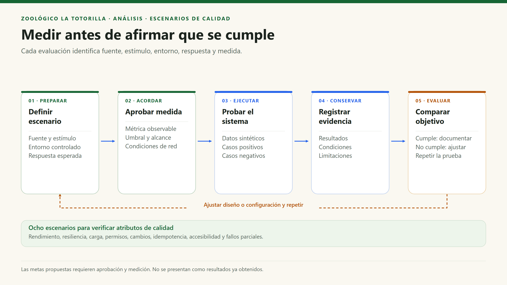

# Escenarios de atributos de calidad

[Índice general](../README.md) · [Atributos](04-atributos-de-calidad.md)

## 1. Cómo interpretar las medidas

Cada escenario identifica fuente, estímulo, entorno, respuesta y medida. Los números de rendimiento/disponibilidad de esta sección son **metas propuestas por validar**, no resultados obtenidos ni SLA contratados. La comprobación funcional se limita a los casos efectivamente ejecutados.

## EQ-01 — Rendimiento de la consulta pública

| Elemento | Descripción |
|---|---|
| Atributo | AC01: rendimiento. |
| Fuente | Visitante en teléfono móvil. |
| Estímulo | Abrir una ficha y buscar un animal en el directorio. |
| Entorno | Producción con recursos representativos, red móvil documentada, caché fría/caliente diferenciada. |
| Respuesta | La página carga y la búsqueda actualiza resultados sin consultar una BD de especies. |
| Medida propuesta | LCP p75 ≤ 2,5 s en fichas y respuesta de filtro p95 ≤ 200 ms después de cargar los datos, en dispositivos y redes acordados. |
| Verificación | Lighthouse/Performance y medición de interacciones; separar primera carga de navegación interna. |
| Estado | Meta por aprobar y medir; no hay evidencia de benchmark incluida aquí. |

## EQ-02 — Disponibilidad ante fallo de tarifas remotas

| Elemento | Descripción |
|---|---|
| Atributo | AC02: resiliencia. |
| Fuente | Fallo de red o Data API. |
| Estímulo | La consulta de `tariff_overrides` falla durante la carga de Entradas. |
| Entorno | SPA y recursos estáticos disponibles; servicio remoto interrumpido. |
| Respuesta | La aplicación conserva tarifas base y permite consultar contenido estático. |
| Medida | En los casos de prueba, la página no queda en blanco y muestra valores de `tickets.config.ts`. No prometer que esos precios sean los últimos publicados. |
| Verificación | Simular rechazo de red y revisar la página y `useTariffs`. |
| Estado | Mecanismo implementado; revisión manual y automatización específica pendientes. |

## EQ-03 — Escalabilidad y límites de archivos

| Elemento | Descripción |
|---|---|
| Atributo | AC05: escalabilidad/coste. |
| Fuente | Incremento simultáneo de visitantes y subidas. |
| Estímulo | Aumentar carga desde 10 hasta 100 sesiones concurrentes. |
| Entorno | Entorno de pruebas autorizado con cuotas de proveedores y datos sintéticos. |
| Respuesta | Mantener consulta pública y rechazar controladamente excesos, sin archivos inválidos ni secretos expuestos. |
| Medida propuesta | Consultas HTTP p95 ≤ 3 s y menos de 1 % de errores técnicos, excluyendo rechazos esperados; acordar metas separadas para procesamiento de imágenes. |
| Verificación | Prueba de carga escalonada; registrar CPU/latencia, límites, errores y coste. No ejecutarla contra producción sin autorización. |
| Estado | Carga/metas por validar. CDN y serverless no certifican capacidad ilimitada. |

## EQ-04 — Autorización y privacidad

| Elemento | Descripción |
|---|---|
| Atributo | AC03: seguridad. |
| Fuente | Usuario sin sesión, sesión anónima o usuario sin membresía. |
| Estímulo | Aprobar foto, cambiar tarifas o leer documentos/reclamos mediante llamadas directas. |
| Entorno | API y políticas aplicadas con identidades de prueba. |
| Respuesta | Rechazo HTTP o ausencia de filas visibles según operación; ningún cambio protegido. |
| Medida | Rechazar el 100 % de los casos no autorizados definidos y verificar ausencia de mutaciones. El porcentaje solo se refiere a la suite, no a todos los ataques posibles. |
| Verificación | `tests/photos.test.mjs` y `supabase/tests/security.sql`, inspección de grants y RLS. |
| Estado | Hay pruebas automatizadas; ejecutar las del entorno correspondiente y conservar resultados. |

## EQ-05 — Mantenibilidad de los datos educativos

| Elemento | Descripción |
|---|---|
| Atributo | AC04: mantenibilidad. |
| Fuente | Equipo de desarrollo. |
| Estímulo | Cambiar imagen, audio o descripción de una especie existente. |
| Entorno | Repositorio con estructura actual y recursos disponibles. |
| Respuesta | Cambio localizado en datos de especie, mapeo de miniatura si corresponde y `public/`; sin cambios en API privadas. |
| Medida | Build correcto, referencias válidas y ausencia de modificaciones no relacionadas en Auth, reclamaciones o tablas. |
| Verificación | Revisar diff; `npm run build`; abrir ficha y directorio. |
| Estado | Diseño implementado; no presupone edición desde el panel. |

## EQ-06 — Reintentos de reclamación

| Elemento | Descripción |
|---|---|
| Atributo | AC06: integridad. |
| Fuente | Consumidor tras un timeout. |
| Estímulo | Repetir la misma clave de envío, con datos iguales o distintos. |
| Entorno | Libro habilitado y datos sintéticos. |
| Respuesta | Iguales: recuperar hoja existente; distintos: conflicto 409; el correo no determina si la hoja existe. |
| Medida | Una sola fila para la clave; código/fecha de la hoja se conservan. No exigir numeración sin saltos. |
| Verificación | Tests de `server/claims-api.test.mjs`, SQL y prueba del flujo HTTP con proveedores controlados. |
| Estado | Implementado; tests simulados no acreditan entrega real de correo. |

## EQ-07 — Accesibilidad con teclado y movimiento reducido

| Elemento | Descripción |
|---|---|
| Atributo | AC07: accesibilidad/usabilidad. |
| Fuente | Usuario de teclado o con preferencia de movimiento reducido. |
| Estímulo | Recorrer controles, abrir/cerrar el mapa y enviar un formulario inválido. |
| Entorno | Anchos de 375, 768 y 1440 px; teclado y lector de pantalla seleccionados. |
| Respuesta | Foco visible, Escape cierra diálogo, campos identificados y errores comprensibles; animación reducida. |
| Medida propuesta | Completar los recorridos definidos sin ratón, sin pérdida de foco ni contenido esencial inaccesible. |
| Verificación | Prueba manual, zoom 200 %, lector de pantalla y emulación de `prefers-reduced-motion`. |
| Estado | Hay mecanismos en el código; auditoría completa WCAG pendiente. |

## EQ-08 — Configuración y fallos parciales

| Elemento | Descripción |
|---|---|
| Atributo | AC02, AC08: resiliencia y operación. |
| Fuente | Despliegue sin variables privadas, fallo de Storage o fallo de correo. |
| Estímulo | Ejecutar una operación que requiere el servicio ausente. |
| Entorno | Pruebas controladas; nunca publicar valores de secretos. |
| Respuesta | 503 de configuración; reserva incompleta recuperable; hoja conservada con correo pendiente según caso. |
| Medida | No revelar claves ni falsos éxitos; verificar el estado SQL/Storage antes de reintentar o limpiar. |
| Verificación | Test de variables ausentes; pruebas de API y ejecución supervisada de scripts con datos sintéticos. |
| Estado | Código y scripts disponibles; no se garantiza ejecución automática o recuperación instantánea. |

## 2. Ciclo de evaluación

## 3. Resumen para la exposición

| Escenario | Qué demuestra si pasa | Qué no demuestra |
|---|---|---|
| EQ-01–EQ-03 | Rendimiento y comportamiento bajo las condiciones medidas. | Capacidad o disponibilidad ilimitadas. |
| EQ-04 | Separación de permisos en casos definidos. | Seguridad absoluta. |
| EQ-05 | Localización de cambios y ausencia de regresión observada. | Independencia total de proveedores. |
| EQ-06 | Idempotencia de la hoja y conservación del registro. | Entrega garantizada al buzón o respuesta legal automatizada. |
| EQ-07 | Accesibilidad de los recorridos revisados. | Certificación integral WCAG. |
| EQ-08 | Fallos comunicados y estados recuperables. | Automatización operativa que no esté programada. |
