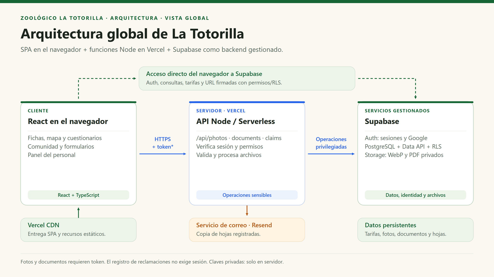

# Arquitectura global del sistema

[Índice general](../README.md) · [Estilo](estilo-arquitectonico.md) · [Enfoque](enfoque-aquitectonico.md) · [Componentes](componentes-arquitectonicos.md)

## 1. Propósito y alcance

Esta vista muestra la solución **actual**, no una arquitectura histórica o un backend hipotético. Se conserva el nombre `arquitectura-inicial.md` para mantener la organización del proyecto de referencia.

La Totorilla es una aplicación web cliente-servidor con frontend React, funciones Node serverless en Vercel y servicios Supabase. El contenido educativo estático y las operaciones persistentes tienen caminos distintos. La publicación de fotos, recepción de documentos y reclamaciones necesitan ejecutar lógica confiable fuera del navegador.

## 2. Diagrama global

También se conserva la [imagen de presentación](../img/arquitectura-cliente-servidor.png), con [versión SVG](../img/arquitectura-cliente-servidor.svg).

## 3. Responsabilidades y límites

| Parte | Responsabilidad | Qué no debe hacer |
|---|---|---|
| Navegador | Mostrar páginas, gestionar interacción, validar para ayudar al usuario y comprimir fotos. | Guardar claves privilegiadas o decidir de forma definitiva quién puede administrar. |
| API Node | Validar entrada no confiable, verificar identidad/permisos y coordinar escrituras privilegiadas. | Confiar en `owner_id` enviado por el usuario o simular un éxito de persistencia. |
| PostgreSQL / Data API | Persistir, aplicar constraints, grants, RLS y cuotas. | Servir públicamente datos personales por tener una clave pública válida. |
| Storage | Guardar objetos privados y emitir accesos temporales autorizados. | Publicar automáticamente todo lo subido. |
| Auth | Gestionar identidades y tokens. | Convertir automáticamente un correo institucional en miembro del personal. |
| Resend | Aceptar solicitudes de envío de copias. | Determinar si existe una hoja ni garantizar que el consumidor la leyó. |

## 4. Dos caminos de acceso a datos

| Caso | Camino real | Protección |
|---|---|---|
| Consultar especies y mapa | React → datos TypeScript y archivos estáticos. | Información pública; no requiere BD. |
| Consultar/modificar tarifas | React → SDK Supabase → Data API. | Lectura pública; modificaciones con RLS y membresía. |
| Listar muro y pedir URL firmadas | React → Data API / Storage. | Filtro de publicadas y políticas por objeto. |
| Subir/moderar foto | React → `/api/photos` → Auth, Sharp, BD y Storage. | Token verificado y permiso administrativo para moderación. |
| Presentar documento | React → `/api/documents` → Auth, BD y Storage. | Sesión válida, validación y cuota. |
| Registrar reclamación | React → `/api/claims` → validación, BD y correo. | Sin login obligatorio; configuración, clave de envío y hash. |
| Consultar bandejas del personal | React → Data API y Storage. | RLS y permisos de membresía. |

**No es una arquitectura de tres capas estrictamente atravesadas por todas las peticiones.** Hay acceso directo controlado a un BaaS. La separación de responsabilidades es lógica, y la API no media todas las lecturas ni todas las escrituras.

## 5. Estructura de implementación

| Ruta | Contenido |
|---|---|
| `src/app/` | Router, layout, guard del panel y navegación por anclas. |
| `src/pages/`, `src/components/` | Presentación. |
| `src/features/` | Servicios, hooks, validaciones y datos por funcionalidad. |
| `src/shared/` | Cliente público Supabase y utilidades comunes. |
| `api/` | Tres puntos de entrada HTTP de negocio. |
| `server/` | Sharp, correo, adaptador de desarrollo, tests y mantenimiento. |
| `shared/` en la raíz | Validación de reclamaciones reutilizada entre navegador y servidor. No confundir con `src/shared/`. |
| `supabase/` | Migraciones y pruebas de seguridad. |

## 6. Ejecución y despliegue

1. Vite compila la SPA; Vercel entrega esos archivos mediante CDN.
2. React Router resuelve rutas de interfaz, incluidas fichas que pueden ser destinos de QR.
3. `/api/*` no se reescribe a `index.html`; Vercel ejecuta el handler correspondiente.
4. El servidor obtiene sus secretos de variables de entorno privadas, distintas de `VITE_*`.
5. En desarrollo, `server/vite-api.mjs` adapta los mismos handlers al middleware de Vite. `preview` solo sirve archivos estáticos.

## 7. Riesgos reconocidos

| Riesgo | Tratamiento actual | Qué queda por operar o mejorar |
|---|---|---|
| Falta de configuración en el host | Respuestas controladas de no disponibilidad. | Verificar variables del despliegue activo y redesplegar. |
| Fallo entre SQL y Storage | Reserva persistida y estados intermedios. | Conciliación y limpieza supervisada; no hay transacción distribuida. |
| Fallo de correo | Hoja conservada y estado pendiente. | Programar reintentos y seguimiento de entrega. |
| Abuso de sesiones anónimas | Cuotas por identidad y límites de archivo. | CAPTCHA/rate limiting del entorno; no son cuotas infalibles por persona. |
| Dependencia de proveedor | Servicios de acceso localizados. | Cambiar Supabase exige adaptar código, políticas y pruebas. |
