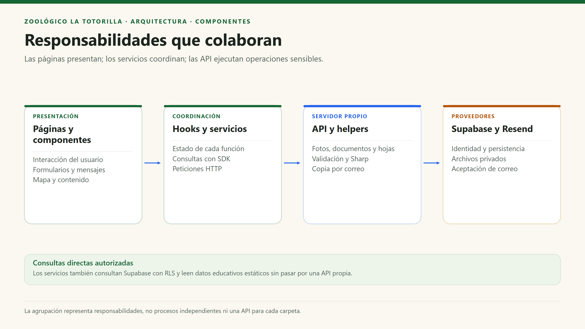

# Componentes arquitectónicos

[Índice general](../README.md) · [Arquitectura global](arquitectura-inicial.md) · [C4 nivel 3](../04-modelo-c4/Nivel3-Diagrama-de-Componentes.md)

## 1. Criterio de descomposición

Un componente agrupa código con una responsabilidad clara y puntos de interacción reconocibles. No significa necesariamente una clase, un proceso o una carpeta con API pública formal. El catálogo siguiente distingue código del navegador, servidor y servicios gestionados.

## 2. Componentes del navegador

| ID | Componente | Responsabilidad | Archivos representativos | Dependencias |
|---|---|---|---|---|
| CP01 | Composición y navegación | Arrancar React, seleccionar rutas, redirigir y compartir layout. | `main.tsx`, `App.tsx`, `app/router.tsx`, `ScrollManager.tsx`. | React, React Router, Auth y componentes visuales. |
| CP02 | Información y mapa | Consultar recintos, buscar especies y presentar normas/historia. | `features/zoo/`, `MapaPage.tsx`, `HomePage.tsx`. | Datos locales y configuración del sitio. |
| CP03 | Contenido educativo | Resolver fichas y coordinar sonidos, tarjetas y quizzes. | `features/animals/`, `AnimalPage.tsx`, `AnimalSound`, `FlipFact`, `Quiz`. | TypeScript y recursos de `public/`. |
| CP04 | Autenticación del personal | Mantener sesión visible y autorizar la UI del panel. | `auth.context.tsx`, `roles.ts`, `RequireAdmin.tsx`. | Supabase Auth y consulta de membresía. |
| CP05 | Comunidad | Listar fotos, comprimir, enviar y solicitar moderación. | `useVisitorPhotos.ts`, `photos.store.ts`, `image.ts`, `PhotoWall.tsx`. | SDK, canvas y `/api/photos`. |
| CP06 | Tarifas | Aplicar valores base/overrides y permitir cambios autorizados. | `tickets.config.ts`, `prices.store.ts`. | Data API y RLS. |
| CP07 | Mesa de Partes | Validar formulario, enviar PDF y consultar documentos del personal. | `documents.ts`, `requests.store.ts`, `MesaDePartesPage.tsx`. | Auth, `/api/documents`, Data API y Storage. |
| CP08 | Reclamaciones | Formulario, validación, constancia y bandeja. | `ClaimsPage.tsx`, `claims.service.ts`, `ClaimsInbox.tsx`. | Validador compartido, `/api/claims` y Data API. |

## 3. Componentes del servidor

| ID | Componente | Contrato / responsabilidad | Integraciones |
|---|---|---|---|
| CS01 | Fotos | `POST/PATCH /api/photos`; token, límites, cuotas y decisiones de revisión. | Supabase Auth, PostgreSQL, Storage y Sharp. |
| CS02 | Documentos | `POST/DELETE /api/documents`; formulario multipart, PDF, consentimiento y borrado autorizado. | Supabase Auth, PostgreSQL y Storage. |
| CS03 | Reclamaciones | `GET/POST /api/claims`; disponibilidad legal, validación e idempotencia. | PostgreSQL y helper de correo. |
| CS04 | Procesamiento de fotos | `sanitizeWebp(input)` decodifica y genera un WebP nuevo sin metadatos. | Sharp. |
| CS05 | Correo de constancias | `sendClaimReceipt(db, claim)` solicita envío y registra estado. | Resend y tabla `consumer_claims`. |
| CS06 | Herramientas operativas | Limpieza de reservas de fotos y reintento de correos pendientes. | SQL/Storage vía SDK; ejecución supervisada. |
| CS07 | Adaptador local | Ejecutar handlers Node desde `npm run dev` con respuesta compatible. | Middleware de Vite; no forma parte del bundle web. |

## 4. Servicios y almacenes gestionados

| Elemento | Papel | Datos / controles |
|---|---|---|
| Supabase Auth | Identidad y validación de tokens. | Cuentas permanentes y anónimas, integración Google. |
| PostgreSQL / Data API | Persistencia relacional accesible por HTTPS. | Cinco tablas públicas, contador privado, constraints, índices, grants y RLS. |
| Storage | Persistencia de archivos privados. | Buckets `visitor-photos` y `request-documents`; URLs firmadas. |
| Vercel CDN / Functions | Entrega y ejecución. | Recursos compilados y variables de entorno por despliegue. |
| Resend | Servicio externo de correo. | Copias de reclamaciones; no expediente ni fuente de verdad del registro. |

## 5. Relaciones principales

## 6. Catálogo de endpoints propios

| Endpoint | Método | Sesión requerida | Resultado principal | Errores relevantes |
|---|---|---|---|---|
| `/api/photos` | POST | Sí, visitante o personal. | 201 con identificador; foto pendiente. | 400, 401, 413, 415, 429, 503. |
| `/api/photos?id=…&action=…` | PATCH | Sí; propietario o administrador según acción. | 200 con acción aplicada. | 400, 401, 403, 404, 409. |
| `/api/documents` | POST | Sí. | 201 con código UUID. | 400, 401, 413, 415, 429, 503. |
| `/api/documents?id=…` | DELETE | Personal autorizado. | 200 con identificador. | 400, 401, 403, 404. |
| `/api/claims` | GET | No. | Configuración pública del proveedor y `ready`. | No devuelve secretos. |
| `/api/claims` | POST | No. | 201 con hoja registrada o recuperada idempotentemente. | 400, 409, 413, 415, 503. |

Los errores no enumerados pueden terminar en 500 controlado. No hay API propia para CRUD de especies, pagos, reservas o respuestas administrativas a reclamaciones.
