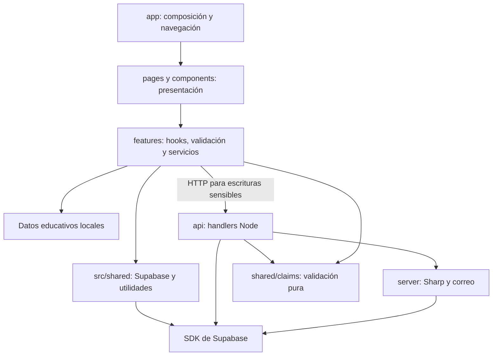

# Enfoque de diseño arquitectónico

[Índice general](../README.md) · [Estilo](estilo-arquitectonico.md) · [Diseño interno](../03-diseño-de-software/diseño-interno/diseño-interno-de-modulos.md)

## 1. Enfoque seleccionado

**Diseño modular por funcionalidades, con separación en capas lógicas.** Se conserva el nombre del archivo de referencia (`enfoque-aquitectonico.md`) para facilitar la correspondencia entre documentos.

| Elemento | Aplicación al zoológico |
|---|---|
| Objetivo | Facilitar que cada cambio se localice en la funcionalidad responsable y que la seguridad no dependa de la UI. |
| Unidad de organización | Funcionalidades: animales, Auth, comunidad, tarifas, solicitudes, reclamaciones e información del zoológico. |
| Responsabilidades lógicas | Presentación; estado/validación/coordinación; acceso a servicios; procesamiento confiable; persistencia y permisos. |
| Dependencias reales | Hooks importan React; servicios importan el SDK Supabase; handlers conocen HTTP, SDK y helpers. |
| Beneficio | Menos capas artificiales y lectura directa del flujo, con reutilización donde existe una necesidad concreta. |
| Coste aceptado | Acoplamiento tecnológico explícito y algunas validaciones duplicadas; no se ha implementado una arquitectura hexagonal. |

## 2. Distribución por carpetas

```text
src/
  app/          router, layout, RequireAdmin, ScrollManager
  components/   piezas visuales reutilizables
  pages/        pantallas asociadas a rutas
  features/     datos, servicios, validaciones y hooks por tema
  shared/       cliente público Supabase y utilidades
api/            entrada HTTP de fotos, documentos y reclamos
server/         procesamiento, correo y mantenimiento
shared/         validación de reclamos compartida entre runtimes
supabase/       esquema, permisos, cuotas y pruebas SQL
```

## 3. Dependencias lógicas observables



Las flechas sin etiqueta HTTP representan imports/uso. `features/` no es una capa de dominio puro: reúne funciones relacionadas para que el proyecto siga siendo fácil de entender.

## 4. Por qué no es Clean Architecture estricta

| Requisito habitual de una implementación estricta | Situación real |
|---|---|
| Dominio independiente de React, HTTP y proveedor de datos. | Algunas validaciones son puras, pero la lógica y coordinación no están completamente aisladas. |
| Casos de uso separados y contratos de persistencia. | No hay carpetas de casos de uso ni interfaces Repository para cada operación. |
| Inyección de implementaciones a través de puertos. | Los servicios construyen/utilizan clientes concretos mediante `getSupabase` o `createClient`. |
| Dependencias dirigidas sistemáticamente hacia el dominio. | Se emplea una separación pragmática; no existe una regla de inversión completa aplicada a todo el código. |

Se aprovechan principios de separación de responsabilidades y funciones testeables, sin afirmar que todos los patrones de Clean Architecture estén implementados. No se propone añadir interfaces vacías solo para que el diagrama parezca más sofisticado.

## 5. Reglas de mantenimiento

| Regla | Aplicación práctica | Excepción o límite |
|---|---|---|
| Los componentes no deberían dispersar consultas SQL/SDK. | Mantener acceso a datos en servicios de la funcionalidad. | Hooks y formularios siguen coordinando estado de UI. |
| Una funcionalidad no usa el cliente privado de otra. | Tarifas usa `src/shared/supabase.ts`, no `photosClient`. | El cliente común es compartido deliberadamente. |
| Lo reutilizable debe tener un uso real. | `shared/claims.mjs` evita divergencias entre validación web y API. | Mesa de Partes aún tiene validación duplicada que debe revisarse al cambiar reglas. |
| Las API nunca importan componentes de UI. | Los handlers usan Node, helpers y contratos de datos. | Reutilizar validadores puros no implica importar React. |
| No crear nuevas capas sin necesidad. | Mantener `app/`, `components/`, `pages/`, `features/` y `shared/` sencillos. | Extraer un módulo si crece o requiere pruebas/uso independiente. |
| La autorización se comprueba donde se realiza la operación. | Verificación en API y políticas SQL, no solo `RequireAdmin`. | El cliente privilegiado omite RLS: el handler conserva responsabilidad. |

## 6. Ejemplo de un cambio localizado

Para modificar la compresión de fotos se revisan `image.ts`, `photo-image.mjs`, límites de API/bucket y tests. No se modifican el router, las fichas ni las tarifas salvo necesidad concreta. Si cambia un límite, deben alinearse interfaz, servidor, SQL y documentación.

## 7. Criterio para evolucionar

Introducir puertos/repositorios o casos de uso separados sería razonable si aparecen múltiples proveedores reales, reglas complejas reutilizadas o pruebas difíciles por acoplamiento. Hasta entonces, la modularidad ligera refleja mejor el tamaño del proyecto y permite explicar su arquitectura sin inventar capas.
