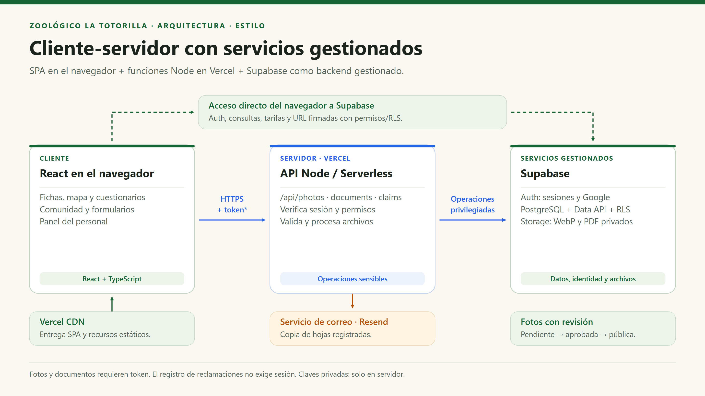

# Estilo arquitectónico: cliente-servidor

[Índice general](../README.md) · [Arquitectura global](arquitectura-inicial.md) · [Enfoque de diseño](enfoque-aquitectonico.md)

## 1. Nombre y justificación

El estilo principal es **cliente-servidor**: la SPA se ejecuta en el navegador y solicita servicios remotos. Las responsabilidades confiables se ejecutan en las funciones de Vercel y en los servicios gestionados de Supabase.

La organización del código es modular y el despliegue utiliza serverless/BaaS. Estos conceptos complementan el estilo, pero no lo sustituyen ni significan que haya microservicios independientes por cada carpeta.

| Concepto | Cómo se aplica aquí | Qué no significa |
|---|---|---|
| Cliente-servidor | React consume API y servicios de Auth/datos/archivos por HTTPS. | Que todo lo que se muestra se consulte en una BD. |
| SPA | React Router cambia vistas en el navegador; recursos compilados en CDN. | Que se pueda ejecutar código privado en el cliente. |
| Modularidad | `features/` agrupa funciones del mismo tema. | Que cada módulo tenga su propio servidor o base de datos. |
| Serverless | Vercel administra la infraestructura de las funciones Node. | Ausencia de servidores, límites o configuración. |
| BaaS | Supabase ofrece Auth, PostgreSQL/Data API y Storage. | Acceso irrestricto ni autorización resuelta por ocultar botones. |
| Capas lógicas | Se separan presentación, coordinación y acceso/persistencia. | Pipeline rígido donde toda llamada pasa por un backend único. |

## 2. Diagrama del estilo

[Versión vectorial en SVG](../img/arquitectura-cliente-servidor.svg).

## 3. Por qué es adecuado para el zoológico

| Necesidad | Respuesta del estilo | Beneficio |
|---|---|---|
| Consulta pública desde teléfonos y QR. | Interfaz web con rutas de especie accesibles por URL. | No exige instalar una aplicación. |
| Fotos no confiables y moderación. | Procesamiento y decisiones del personal en servidor. | No se confía en archivos o permisos declarados por el cliente. |
| Documentos y reclamos privados. | Persistencia con reglas centralizadas y acceso autorizado. | Protección independiente de la interfaz visual. |
| Equipo y operación acotados. | Servicios gestionados y despliegue del mismo proyecto. | Menos administración que servidores completos o microservicios. |
| Cambios frecuentes de interfaz/contenido. | SPA y módulos de funcionalidad. | Evolución localizada sin multiplicar servicios. |

## 4. Comparación con alternativas

| Alternativa | Ventaja posible | Por qué no describe o no conviene al estado actual |
|---|---|---|
| Sitio puramente estático | Muy simple para información pública. | No basta para secretos, archivos, permisos ni registros persistentes. |
| Backend completo con páginas renderizadas | Centraliza reglas y renderizado. | No es lo construido; añadirlo no resuelve por sí solo una necesidad actual. |
| Microservicios | Despliegue y escalado independientes. | No hay demanda demostrada que compense contratos distribuidos, observabilidad y operación adicional. |
| Arquitectura dirigida por eventos | Desacopla procesos asíncronos. | No existen broker, bus ni consumidores; los scripts de reintento no forman un sistema event-driven. |
| Capas estrictas con backend obligatorio | Frontera de API uniforme. | La aplicación usa directamente Data API/Storage con RLS; imponerlo a todo añadiría código. |

## 5. Compromisos y frase para exposición

La sencillez exige mantener bien los permisos, las variables de entorno y los límites de proveedores. La arquitectura no garantiza por sí sola disponibilidad, escalabilidad ilimitada ni cumplimiento normativo.

> «Usamos cliente-servidor: React presenta la información y consume servicios remotos. Las funciones serverless ejecutan operaciones sensibles y Supabase gestiona identidad, datos y archivos. Organizamos la aplicación por funcionalidades para mantenerla sencilla y modificable.»
