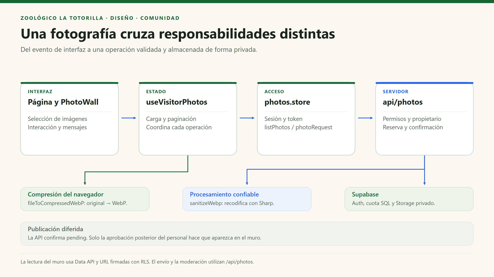
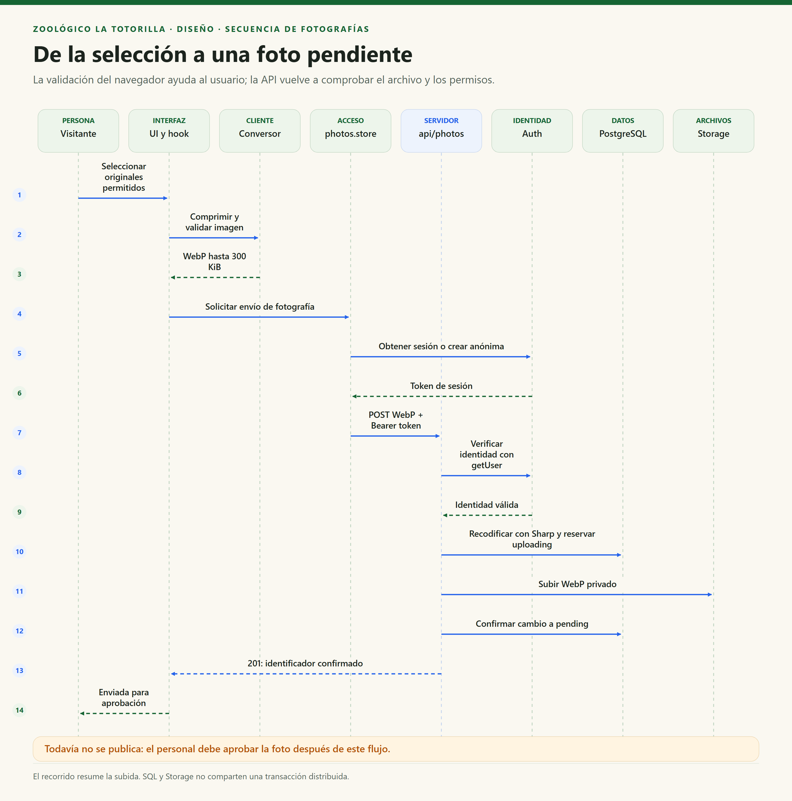
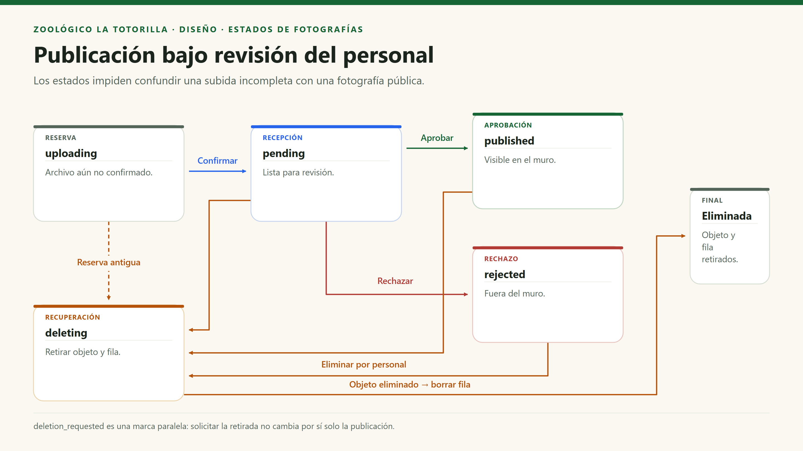
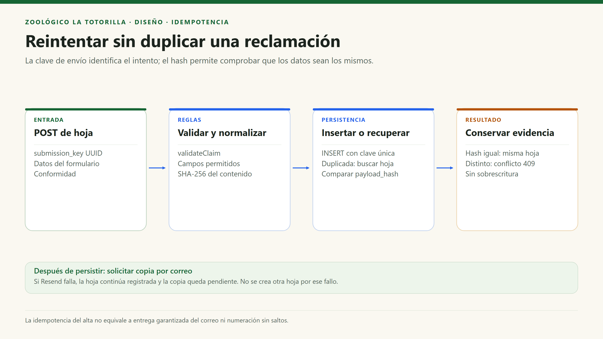

# Diseño interno de módulos

[Índice general](../../README.md) · [Patrones](patrones-de-diseño.md) · [Principios](principios-de-diseño.md)

> **Proyecto:** La Totorilla. **Módulo de referencia:** Comunidad y moderación de fotografías. **Enfoque:** módulos por funcionalidad, funciones, componentes y hooks.

## 1. Propósito

Explicar dónde se localiza cada responsabilidad, cómo se coordinan los módulos y qué sucede cuando una operación no termina correctamente. Se profundiza en Comunidad porque cruza navegador, autenticación, procesamiento de imágenes, BD, Storage y revisión del personal.

## 2. Estructura real del módulo de referencia

```text
src/pages/CommunityPage.tsx                 compone la página pública
src/pages/AdminDashboardPage.tsx            ofrece la revisión del personal
src/components/PhotoWall.tsx                formulario y galería pública
src/features/community/
  useVisitorPhotos.ts                      estado y coordinación de operaciones
  photos.store.ts                          consultas, sesión y peticiones HTTP
  image.ts                                 validación y compresión del original
src/shared/supabase.ts                     cliente público compartido
api/photos.mjs                             entrada HTTP y autorización confiable
server/photo-image.mjs                     recodificación real mediante Sharp
server/cleanup-photos.mjs                   recuperación operativa de incompletas
supabase/migrations/                       tabla, estados, grants, RLS y cuota
tests/photos.test.mjs                      pruebas de validación y API simulada
```

| Archivo / unidad | Responsabilidad | Entrada / salida | Dependencias |
|---|---|---|---|
| `PhotoWall` | Interacción y mensajes; abre el selector y muestra publicadas. | API del hook y eventos del usuario. | React y tipos del hook. |
| `useVisitorPhotos` | Carga, estados de espera/error, paginación y secuencia de subida. | `File[]`, autor, acción; estado observable de UI. | Servicio de fotos, conversor y hooks React. |
| `fileToCompressedWebP` | Validar tamaño/MIME/firma y rasterizar a WebP pequeño. | `File → Promise<Blob>`. | Bitmap, canvas y APIs del navegador. |
| `listPhotos` | Consultar filas visibles y solicitar URL firmadas. | Modo/página → fotos de presentación y `hasMore`. | Cliente público Supabase y RLS. |
| `photoRequest` | Obtener token y llamar a la API propia. | Método, query y Blob opcional → confirmación o error. | Auth y `fetch`. |
| `handler` de fotos | Validar petición, sesión y permiso de la acción. | HTTP → estado y JSON. | SDK privilegiado, UUID, Sharp y Storage. |
| `sanitizeWebp` | Verificar/decodificar WebP real y generar un objeto limpio. | Buffer → datos y dimensiones. | Sharp; no confía en nombre o extensión. |
| `enforce_submission_quota` | Control diario atómico por identidad. | Inserción SQL → reserva aceptada o excepción. | Contador privado de PostgreSQL. |

## 3. Dependencias del módulo



`photos.store.ts` no implementa un store Redux ni un repositorio abstracto: es un módulo de funciones de acceso. La extensión del nombre no determina un patrón que el código no utiliza.

## 4. Secuencia de envío de una foto



### Revisión posterior

El administrador autenticado envía `PATCH` con `approve` o `reject`. El servidor comprueba membresía y que la sesión no sea anónima. Solo acepta la decisión si la foto sigue `pending`. La actualización compara estado y marca de eliminación para detectar cambios concurrentes; guarda revisor y fecha. La próxima consulta pública incorpora únicamente las aprobadas.

## 5. Estados y transiciones



| Estado / marca | Quién la establece | Efecto |
|---|---|---|
| `uploading` | API al reservar. | Operación incompleta; no se publica. |
| `pending` | API tras confirmar Storage. | Disponible para revisión; fuera del muro público. |
| `published` | Personal mediante API. | Visible en el muro público. |
| `rejected` | Personal mediante API. | No se publica. No existe acción de reapertura en la API actual. |
| `deleting` | Decisión administrativa o script de recuperación. | Permite reintentar eliminación de archivo/fila. |
| `deletion_requested` | Propietario solicita retirada. | Es una marca paralela, no un estado; no significa eliminación inmediata. |

## 6. Modelo de datos relevante

| Campo / relación | Finalidad | Regla |
|---|---|---|
| `id` | Identificador de foto. | UUID; no usar nombre de autor como clave. |
| `owner_id` | Propietario real. | FK a Auth, obtenido de token verificado. |
| `object_path` | Relación con Storage. | Debe ser `owner_id/id.webp`; única. |
| `width`, `height`, `byte_size` | Metadatos técnicos de la salida real. | Límites SQL adicionales al procesamiento. |
| `status` | Ciclo de vida. | Conjunto de valores restringido. |
| `reviewed_by`, `reviewed_at` | Evidencia de decisión. | Los establece la aprobación/rechazo del personal. |
| `deletion_requested_at`, `last_actor_id` | Solicitud y último actor de una modificación. | No equivalen a un historial de auditoría completo. |
| `private.daily_submissions` | Cuota diaria. | Hasta 12 reservas de foto por identidad/día de Lima; contador atómico. |

El límite por identidad no es un control infalible por persona: perder `sessionStorage`, usar otro navegador o una nueva sesión anónima puede generar otra identidad.

## 7. Otros módulos y contratos

| Módulo | Datos / funciones | Flujo y límites |
|---|---|---|
| Animales | `Animal`, `getAnimalBySlug`, `getOtherAnimals`. | Datos locales; no hay tabla de especies ni CMS. |
| Zoológico | `MAP_ENCLOSURES`, `MAP_ANIMALS`, búsqueda normalizada. | Relación de especies y recintos; no todas las especies tienen ficha o posición. |
| Tarifas | Tipos base, `refreshPrices`, `savePriceOverride`, reset. | Acceso directo Data API con RLS; no se mezcla con servicio de fotos. |
| Auth | `AuthProvider`, `useAuth`, OAuth y membresía. | Estado del personal para UI; no reemplaza autorización de cada operación. |
| Mesa de Partes | `DocumentDetails`, `validateDocument`, `saveRequest`, `listRequests`. | Token, multipart, PDF opcional, reserva y confirmación; tabla histórica `discount_requests`. |
| Reclamaciones | `ClaimFields`, `validateClaim`, `submitClaim`, `listClaims`. | Sin sesión para registrar; clave única, hash y copia por correo posterior. |

## 8. Reclamaciones: coordinación e idempotencia



`shared/claims.mjs` se usa tanto en navegador como en servidor. La API no importa React. La numeración usa una secuencia de PostgreSQL y puede presentar saltos; no se reinicia para satisfacer una expectativa de continuidad perfecta.

## 9. Fallos parciales y recuperación

| Falla | Estado posible | Tratamiento |
|---|---|---|
| Cuota o validación rechazada | Sin objeto confirmado. | Error controlado; no publicar. |
| Timeout al subir una foto | Reserva `uploading`; objeto puede existir o no. | No borrar a ciegas; el script limpia antiguas con comprobación de estado. |
| Error al pasar a `pending` | Objeto privado y reserva incompleta. | No afirmar publicación; conciliación posterior. |
| Error al eliminar objeto | Foto `deleting`. | Reintentar eliminación antes de quitar la fila. |
| Documento con PDF incompleto | `submission_status = uploading`. | Se excluye de bandeja recibida; requiere conciliación específica. No hay script equivalente demostrado para documentos. |
| Fallo de correo | Hoja persistida, correo pendiente. | Reintento mediante herramienta operativa; no repetir el alta por ese motivo. |

## 10. Pruebas y evolución

| Aspecto | Evidencia de prueba | Límite |
|---|---|---|
| Archivos y aprobación | `tests/photos.test.mjs`, `server/photo-image.test.mjs`. | SDK/HTTP simulados o procesamiento local; no certifican configuración de producción. |
| Reclamaciones | `server/claims.test.mjs`, `server/claims-api.test.mjs`. | Deben ejecutarse; correo real requiere prueba aparte. |
| Validación documental | `server/document-validation.test.mjs`. | El PDF no pasa por un antivirus. |
| RLS y cuotas | `supabase/tests/security.sql`. | Ejecutar como rol autorizado en entorno controlado; rollback evita conservar fixtures. |

El diseño puede crecer extrayendo coordinadores o contratos cuando la complejidad lo justifique. No hace falta convertir cada función en clase para describirla ni para probarla.
