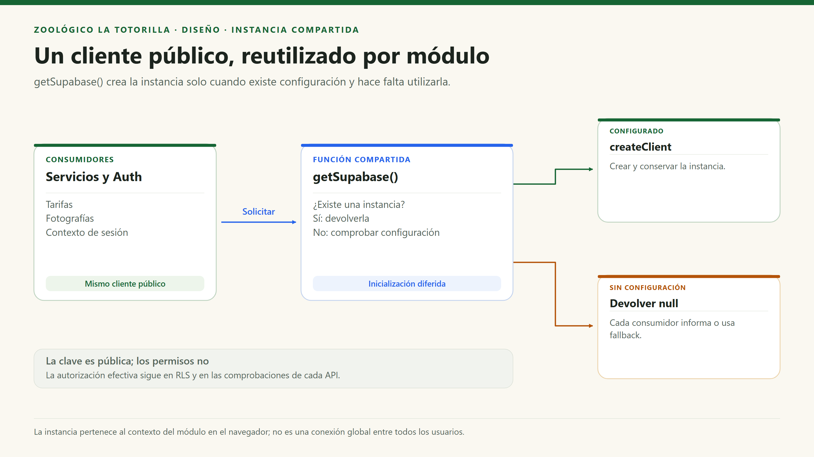
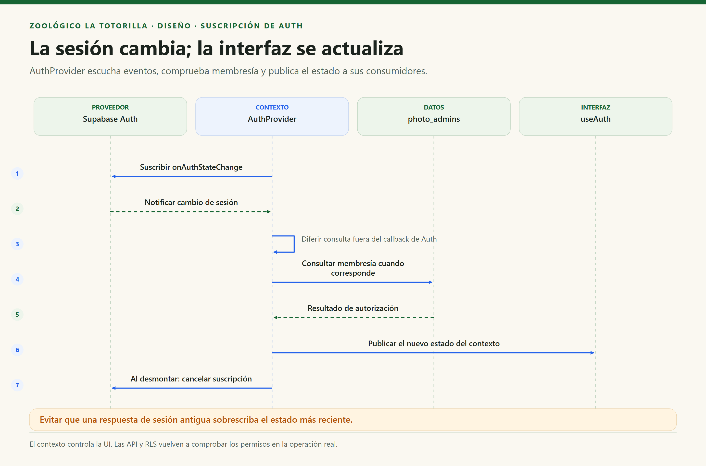

# Patrones y mecanismos de diseño

[Índice general](../../README.md) · [Diseño interno](diseño-interno-de-modulos.md) · [Principios](principios-de-diseño.md)

## 1. Objetivo y criterio de identificación

Identificar mecanismos **presentes en el código**, distinguir patrones clásicos de convenciones funcionales y explicar sus límites. No se copian Repository, Strategy o Decorator de otro proyecto si aquí no existen sus contratos y colaboraciones.

## 2. Catálogo con evidencia

| Patrón / mecanismo | Dónde se usa | Problema que resuelve | Cómo se implementa | Límite de la afirmación |
|---|---|---|---|---|
| Instancia compartida con inicialización diferida, similar a Singleton | `src/shared/supabase.ts`. | Evitar crear un cliente público por componente. | Variable de módulo y `getSupabase()`. | No es una clase Singleton GoF; es una instancia por contexto del módulo, no una conexión global para todos los usuarios. |
| Observación / suscripción | `auth.context.tsx`. | Actualizar la UI al cambiar la sesión. | `onAuthStateChange`, estado y cancelación de la suscripción. | Patrón de eventos del SDK, no un bus de eventos de negocio. |
| Context + Provider | `AuthProvider` y `useAuth`. | Compartir estado de autorización de UI. | Contexto React y hook consumidor. | No sustituye RLS o verificación del token en API. |
| Servicio de aplicación/acceso, de forma funcional | `photos.store.ts`, `claims.service.ts`, `requests.store.ts`, `prices.store.ts`. | Evitar repetir consultas y detalles HTTP en cada componente. | Funciones con entradas y resultados explícitos. | No es Repository abstracto ni dominio independiente del proveedor. |
| Adaptación de protocolo | `server/vite-api.mjs`. | Reutilizar handlers Vercel en el middleware de Vite. | Añade `status()` y `json()` a la respuesta Node y enruta `/api/*`. | Adaptador concreto que solo participa en el entorno de desarrollo. |
| Modelo de estados | Fotos y documentos. | Controlar qué operaciones son válidas en cada etapa. | Campos de estado y condiciones SQL/HTTP. | No hay clases GoF State ni motor de workflow. |
| Idempotency Key | Reclamaciones. | Evitar otra hoja tras reintentar una petición. | UUID único, hash de contenido y recuperación de registro. | No vuelve idempotentes automáticamente fotos/documentos ni todos los efectos externos. |
| Control optimista de concurrencia | Moderación y limpieza de fotos. | Detectar decisiones basadas en datos antiguos. | `UPDATE ... WHERE id/status/deletion_requested` y comprobar filas cambiadas. | No es un lock global de toda la aplicación. |
| Reserva antes del efecto externo | Fotos y documentos. | Aplicar cuota y dejar rastro antes de Storage. | SQL primero, objeto después, estado confirmado al final. | No es transacción distribuida ni saga formal con compensaciones garantizadas. |

## 3. Ejemplo: instancia compartida

El módulo retorna `null` si no tiene configuración. Cada consumidor decide cómo tratarlo: tarifas conserva su fallback; Auth marca que no está configurado; una operación que requiere persistencia informa el fallo. No se debe sustituir la clave pública por una privilegiada.

## 4. Ejemplo: suscripción al estado de Auth

La revisión incremental del contexto evita aplicar una respuesta antigua sobre un estado de sesión más reciente. No se afirma que todas las peticiones del sistema se actualicen por eventos: el muro se refresca con consultas, intervalo y visibilidad.

## 5. Idempotencia frente a concurrencia optimista

| Pregunta | Idempotencia de reclamos | Concurrencia de fotos |
|---|---|---|
| ¿Qué riesgo resuelve? | Repetir el mismo registro por timeout. | Aprobar/eliminar usando un estado que ya cambió. |
| ¿Qué dato usa? | `submission_key` y `payload_hash`. | `id`, `status` y `deletion_requested`. |
| ¿Qué hace ante repetición/conflicto? | Recupera hoja si coincide; si no, 409. | Actualiza solo si coinciden condiciones; si no, 409. |
| ¿Dónde se apoya? | Restricción única y comparación de hash. | Escritura SQL condicional y conteo de filas. |
| ¿Qué no garantiza? | Entrega del correo ni secuencia sin saltos. | Atomicidad entre SQL y Storage. |

## 6. Patrones que no deben atribuirse al sistema

| Nombre | Situación actual | Cuándo evaluarlo |
|---|---|---|
| Strategy de proveedores | No hay múltiples proveedores seleccionados por contrato. | Si correo, almacenamiento o identidad necesitan alternativas reales. |
| Decorator con Redis | No existe Redis ni repositorio decorado. | Si la medición demuestra un cuello de botella en lecturas persistentes. |
| Event bus / CQRS / Saga | No hay infraestructura equivalente ni segregación formal de modelos. | Solo con necesidades de integración, consistencia o escala justificadas. |

## 7. Beneficio de documentar con precisión

La modularidad ya aporta valor sin etiquetar cada helper como patrón GoF. Para defender el diseño, se debe señalar la función concreta, el problema que resuelve y la limitación aceptada. Un patrón previsto se presenta como propuesta, nunca como código existente.
