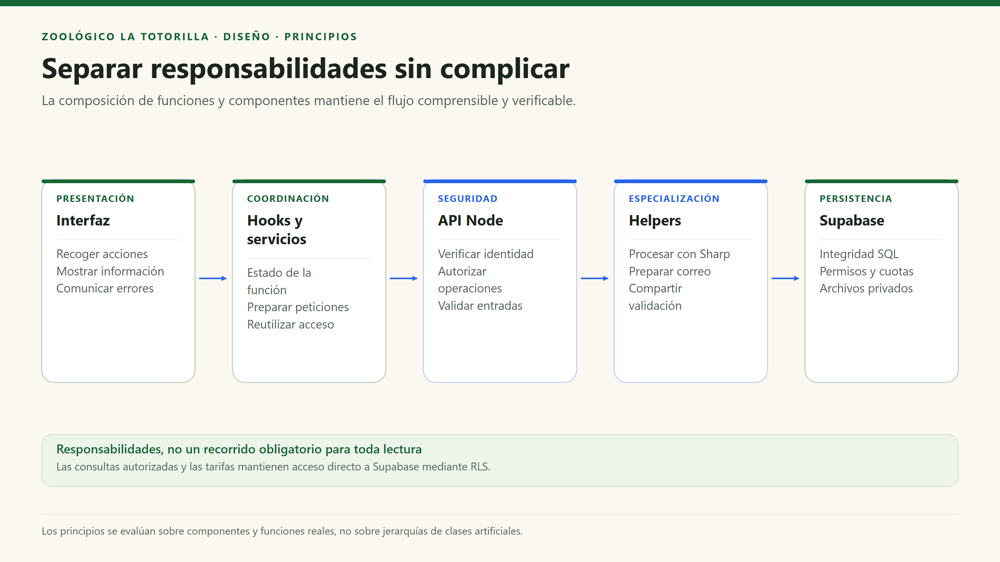

# Principios de diseño y evaluación de SOLID

[Índice general](../../README.md) · [Diseño interno](diseño-interno-de-modulos.md) · [Patrones](patrones-de-diseño.md)

## 1. Objetivo

Explicar los principios aplicables a un proyecto React/TypeScript y Node basado mayormente en funciones. SOLID no obliga a usar clases; tampoco debe declararse «cumplido» sin contratos o colaboraciones que permitan demostrarlo.

## 2. Evaluación honesta de SOLID

| Principio | Evidencia real | Beneficio | Límite / deuda técnica |
|---|---|---|---|
| S — Responsabilidad única | `PhotoWall` presenta; `image.ts` prepara originales; `photo-image.mjs` recodifica; `claim-mail.mjs` envía copia. | Permite revisar y probar preocupaciones distintas. | Los handlers y `AdminDashboardPage` todavía concentran varias responsabilidades de coordinación/UI. |
| O — Abierto/cerrado | Datos de especies y tipos de tarifa separados de sus vistas. | Se puede añadir contenido sin reescribir el componente de ficha. | Agregar proveedores o nuevos estados sí requiere modificar código; no hay Strategy ni plugin de dominio universal. |
| L — Sustitución de Liskov | No hay una jerarquía de clases de negocio relevante. | Evita introducir herencia artificial solo para el documento. | No corresponde afirmar que dos proveedores cumplen Liskov cuando no existen interfaces/implementaciones alternativas. |
| I — Segregación de interfaces | Tipos de datos y funciones concretas como `DocumentDetails`, `ClaimFields`, `VisitorPhoto`. | Contratos acotados a cada flujo y validación más clara. | Los tipos de datos no reemplazan la validación en tiempo de ejecución. |
| D — Inversión de dependencias | Validación pura compartida de reclamos; UI llama servicios en vez de dispersar cada consulta. | Parte de las reglas es testeable sin UI. | No se aplica de forma completa: servicios y API conocen Supabase, React o HTTP directamente. |

**Conclusión:** predominan separación de responsabilidades, composición y modularidad. Los principios se evalúan sobre las funciones, componentes y servicios existentes, sin introducir clases artificiales.

## 3. Principios prácticos que guían el proyecto

| Principio | Aplicación | Ejemplo | Cómo comprobarlo |
|---|---|---|---|
| Alta cohesión | Reunir funciones y datos del mismo tema. | `features/animals/` contiene datos y consultas. | Revisar que un cambio de especie no necesite tocar autenticación. |
| Bajo acoplamiento innecesario | Usar dependencias comunes en vez de un módulo ajeno. | Tarifas usa `shared/supabase`, no el cliente de Comunidad. | Inspeccionar imports. |
| DRY con criterio | Compartir reglas que deben coincidir entre runtimes. | `shared/claims.mjs`. | Comparar validación de formulario y API. |
| KISS / YAGNI | No crear capas o interfaces sin una necesidad real. | Carpetas `app/` y `shared/` planas. | Justificar cada nueva abstracción con usos/pruebas concretos. |
| Composición sobre herencia | Construir páginas con componentes y hooks. | `AnimalPage` usa sonido, tarjetas y quiz. | No hace falta una clase base para cada especie. |
| Mínimo privilegio | No distribuir permisos de servidor al navegador. | Clave pública + RLS; `service_role` solo en API. | Auditar bundle, grants y variables por entorno. |
| Defensa en profundidad | Validación de UX, validación confiable y restricciones SQL. | Archivo permitido, Sharp y bucket privado. | Intentar enviar directamente un archivo o acción inválida. |
| Fallar de forma segura | Rechazar operaciones sin configuración o permiso. | 503 si faltan variables; denegación de aprobación a visitantes. | Pruebas negativas y ausencia de efectos secundarios. |
| Información veraz al usuario | No confundir aceptación con entrega o atención. | Correo pendiente y documento recibido, no aprobado. | Revisar mensajes y estados reales. |

## 4. Diagrama de separación de responsabilidades

Este diagrama ilustra responsabilidades, no impone que todas las lecturas atraviesen todos los bloques. Las tarifas y consultas autorizadas conservan acceso directo al BaaS.

## 5. Ejemplos de cambio y efecto esperado

| Cambio | Localización esperada | No sería aceptable |
|---|---|---|
| Ajustar una descripción de especie | `animals.data.ts`. | Copiar una nueva página completa con lógica duplicada. |
| Cambiar el máximo de una foto | Validación cliente, API/helper, bucket/SQL si afecta salida, tests y mensajes. | Cambiar solo `accept` o el texto del formulario. |
| Modificar una regla de reclamación | Validador compartido y sus pruebas; revisar límites SQL/contrato. | Validar distinto en navegador y servidor sin una razón. |
| Cambiar permisos administrativos | API, membresía y RLS; UI como reflejo. | Dar permiso cambiando únicamente una variable de React. |
| Añadir otro proveedor de correo | Evaluar extracción de un contrato si hay alternativas reales. | Afirmar que hoy es intercambiable sin adaptar la integración. |

## 6. Deuda técnica visible y prioridad

| Hallazgo | Riesgo | Mejora propuesta, no implementada por esta documentación |
|---|---|---|
| Validación de Mesa de Partes repetida en cliente/API. | Divergencia de reglas. | Extraer un validador puro común cuando se revise ese flujo. |
| Coordinación extensa en handlers/panel. | Más difícil aislar errores y pruebas. | Extraer funciones con propósito claro al crecer; no duplicar capas por anticipado. |
| SDK concreto en servicios. | Cambiar proveedor requiere cambios internos. | Mantener el acceso localizado y probar los contratos de cada servicio. |
| Identidad anónima ligada a sesión del navegador. | Propiedad y cuota pueden perder continuidad. | Definir política de identidad/abuso y consentimiento antes de ampliar persistencia. |
| Mantenimiento sin programación demostrada. | Acumulación de archivos/estados incompletos. | Acordar ejecución, monitoreo, retención y responsables. |

## 7. Revisión antes de integrar cambios

1. Confirmar que la responsabilidad pertenece al módulo elegido y no a otro.
2. Revisar entradas no confiables y permisos en la operación real.
3. Mantener alineados los contratos de cliente, servidor y SQL.
4. Ejecutar build, lint y pruebas pertinentes; no ocultar advertencias o límites.
5. Documentar qué se verificó realmente, sin convertir una propuesta en una garantía.
