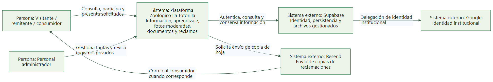
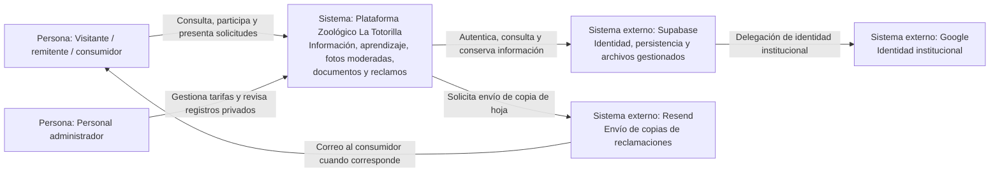

# C4 · Nivel 1 — Contexto del sistema

[Índice general](../README.md) · [Siguiente: contenedores](Nivel2-DiagramadeContenedores.md)

## 1. Objetivo y alcance

Mostrar La Totorilla como una sola caja: quién la utiliza, qué valor entrega y con qué servicios externos se relaciona. Esta vista no divide React, API o tablas; esa apertura corresponde al nivel 2.

| Aspecto | Descripción |
|---|---|
| Pregunta | ¿Qué es el sistema, quién lo usa y de qué servicios depende? |
| Audiencia | Docentes, personal del zoológico, usuarios y equipo técnico. |
| Sistema en alcance | Plataforma web de información, educación, comunidad, documentos y reclamaciones. |
| Sistemas externos | Servicios gestionados Supabase, identidad Google y correo Resend. |
| Qué se omite | Estructura de carpetas, funciones, tablas y librerías. |
| Límite | Los proveedores se representan externos aunque el proyecto configure sus datos y permisos. |

## 2. Diagrama de contexto

[Abrir PNG](diagramas/nivel1-contexto.png) · [Abrir SVG](diagramas/nivel1-contexto.svg)

Ver fuente editable Mermaid

Las líneas representan relaciones de uso, no todas las respuestas HTTP. Google no recibe la `service_role` ni decide quién pertenece a `photo_admins`.

## 3. Personas y necesidades

| Persona | Necesidad | Acceso |
|---|---|---|
| Visitante | Planificar recorrido, consultar recintos/fichas y recursos educativos. | Público. |
| Visitante participante | Enviar fotos y solicitar retirada de las propias. | Sesión, anónima cuando corresponde; publicación sujeta a personal. |
| Remitente | Presentar documentos con datos de contacto y PDF opcional. | Sesión válida; recepción no equivale a aprobación. |
| Consumidor / representante | Registrar una hoja y conservar evidencia. | No requiere cuenta para reclamar; campos y conformidad obligatorios. |
| Administrador | Modificar tarifas, moderar y consultar información privada. | Identidad institucional y autorización explícita. |

No son aplicaciones diferentes ni tablas separadas por actor; una persona puede cumplir varios papeles.

## 4. Sistemas y responsabilidades

| Sistema | Tipo | Responsabilidad | Control del equipo |
|---|---|---|---|
| La Totorilla | Sistema en alcance. | Implementar interfaz, validaciones, coordinación y operaciones del zoológico. | Código, diseño, configuración y despliegue. |
| Supabase | Plataforma externa gestionada. | Sesiones, datos y objetos privados. | El equipo configura esquema, permisos y uso; no administra toda la infraestructura del proveedor. |
| Google | Proveedor externo de identidad. | Autenticar una cuenta para OAuth. | Configuración de integración, no control de la cuenta Google. |
| Resend | Proveedor externo de correo. | Aceptar el envío de copias. | Remitente/clave/configuración y tratamiento de resultados. |

Vercel se detalla en despliegue y contenedores; es infraestructura de ejecución, no un actor de negocio que envía trámites.

## 5. Relaciones y su significado

| Origen | Destino | Información intercambiada | Restricción |
|---|---|---|---|
| Público | La Totorilla | Búsquedas, navegación, fotos, documentos o reclamaciones. | Validación y límites del flujo. |
| Administrador | La Totorilla | Decisiones y consultas privadas. | No basta tener correo institucional. |
| La Totorilla | Supabase | Identidad, datos de negocio y archivos. | Permisos según cliente público o servidor. |
| Supabase Auth | Google | Flujo de identidad institucional. | Redirecciones y proveedor correctamente configurados. |
| La Totorilla | Resend | Destinatario y contenido de la hoja para copia. | Secretos de servidor; aceptar no acredita entrega efectiva. |

## 6. Supuestos y exclusiones

| Tema | Estado |
|---|---|
| Entradas y estacionamiento | Información de tarifas; no hay pasarela de pago. |
| QR en jaulas | Puede apuntar a una URL de especie existente; no hay sistema de inventario/generación QR. |
| Contenido de especies | Mantenido por código y recursos; no hay CMS externo. |
| Operación institucional | Responsables legales, retención y plazos deben definirse fuera de este diagrama. |
| Sistemas que no existen aquí | ERP, courier, vendedores, carrito, facturación y Redis del ejemplo no se trasladan al zoológico. |

## 7. Cómo explicarlo

> «El visitante consulta y presenta información; el administrador revisa y gestiona. Nuestra plataforma se apoya en Supabase para identidad y persistencia, en Google para el login institucional y en Resend para enviar copias de reclamaciones. Esta vista no entra todavía en cómo está dividido el código.»
