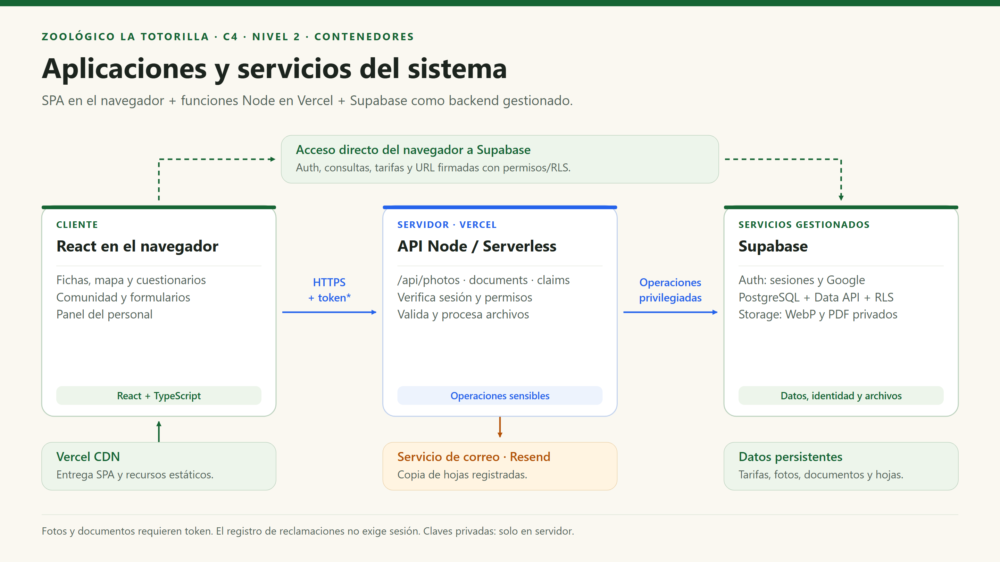

# C4 · Nivel 2 — Contenedores

[Índice general](../README.md) · [Anterior: contexto](Nivel1-DiagramadeContextodelSistema.md) · [Siguiente: componentes](Nivel3-Diagrama-de-Componentes.md)

## 1. Objetivo

Abrir el sistema del nivel 1 e identificar aplicaciones y almacenes que ejecutan o conservan responsabilidades distintas. **Contenedor C4 no significa contenedor Docker.** El repositorio no necesita Docker para que exista esta vista.

| Aspecto | Descripción |
|---|---|
| Pregunta | ¿Dónde se ejecuta cada responsabilidad y cómo se comunica? |
| Audiencia | Equipo de desarrollo, arquitectura y operación. |
| Aplicaciones propias | SPA en navegador y grupo lógico de tres funciones HTTP Node. |
| Servicios gestionados | Auth, Data API/PostgreSQL y Storage en Supabase. |
| Advertencia | La caja de API agrupa funciones para comprenderlas; no representa un proceso Express único ni despliegues de microservicios independientes. |

## 2. Diagrama de contenedores

## 3. Contenedores y servicios

| Elemento | Tecnología | Responsabilidad | Datos que maneja |
|---|---|---|---|
| SPA | React 19, TypeScript, React Router, Tailwind CSS. | Páginas, formularios, mapa, aprendizaje y panel. | Estado de UI; sesión en `sessionStorage`; contenido educativo empaquetado. |
| API serverless | Node ESM y SDK Supabase; Sharp para imágenes. | Validación confiable, autorización y coordinación de fotos, documentos y hojas. | Cuerpos limitados y credenciales solo en memoria/entorno del servidor. No tiene BD local propia. |
| Auth | Servicio Supabase. | Sesiones anónimas y login Google. | Usuarios y sesiones del proveedor. |
| Data API | Servicio Supabase sobre PostgreSQL. | Publicar acceso autorizado a datos. | Peticiones SDK; no implica conexión SQL directa del navegador. |
| PostgreSQL | Base relacional gestionada. | Persistencia, integridad, cuotas y autorización. | Tarifas, fotos, documentos, reclamos, membresías y contadores privados. |
| Storage | Buckets privados Supabase. | Guardar y servir objetos bajo acceso temporal. | WebP procesados y PDF. |
| Correo | API externa Resend. | Solicitar entrega de copias de hojas. | Destinatario y contenido del correo; resultado de aceptación. |

## 4. Relaciones y contratos

| Origen → destino | Finalidad | Formato / protocolo | Autorización |
|---|---|---|---|
| Navegador → CDN | Descargar aplicación y recursos. | HTTPS. | Recursos públicos. |
| SPA → Auth | Obtener sesión, OAuth o usuario anónimo. | SDK/HTTPS. | Clave pública; configuración de Auth. |
| SPA → Data API | Tarifas, fotos visibles y bandejas autorizadas. | SDK/HTTPS/JSON. | Token cuando corresponda + grants/RLS. |
| SPA → Storage | Obtener enlaces y leer objetos permitidos. | HTTPS y URL firmadas. | Políticas de objeto; enlace con expiración. |
| SPA → `/api/photos` | Enviar WebP o acción de moderación. | POST binario / PATCH con query. | Bearer verificado; rol/propiedad según acción. |
| SPA → `/api/documents` | Presentar formulario o eliminar. | POST multipart / DELETE. | Sesión válida; personal para borrar. |
| SPA → `/api/claims` | Configuración pública o registro de hoja. | GET / POST JSON. | Registro sin sesión obligatoria, con validación y configuración habilitada. |
| API → Supabase | Verificar identidad y ejecutar efectos. | SDK sobre HTTPS. | Cliente privilegiado; permisos comprobados por el handler. |
| API → Resend | Copia de reclamación. | HTTPS/JSON. | Clave privada y remitente verificado. |

## 5. Seguridad entre contenedores

| Frontera | Control | Límite |
|---|---|---|
| Navegador / servidor | Variables privadas no incluidas en `VITE_*`. | Una clave secreta publicada debe rotarse; ocultar un botón no la protege. |
| Cliente público / BD | Grants mínimos y RLS. | `authenticated` incluye sesiones anónimas; no es sinónimo de administrador. |
| Cliente privilegiado / BD | Validación y autorización explícitas del handler. | `service_role` evita RLS, pero no los permisos SQL que se hayan revocado expresamente. |
| Archivo / almacenamiento | Recodificación, límites y bucket privado. | PDF reconocible no equivale a PDF sin malware. |
| Enlace firmado / usuario | Vigencia limitada. | Puede seguir funcionando hasta vencer aunque se retire un permiso. |

## 6. Decisiones reflejadas y operación

La SPA y las funciones pertenecen al mismo proyecto de Vercel; Supabase y Resend se despliegan/operan como servicios externos. El modelo no promete independencia total de despliegue entre módulos internos.

En local, Vite puede ejecutar los handlers con su adaptador. En producción, Vercel los ejecuta directamente. El middleware local no se convierte en un contenedor adicional del sistema de producción. Los scripts de limpieza/reintento son herramientas de operación y no se dibujan como workers permanentes o cron ya programados.

## 7. Qué no existe en esta vista

No hay Redis, broker, gateway propio, servidor Express persistente, contenedores Docker, clúster Kubernetes ni base de datos separada por módulo. Añadirlos al dibujo sin código o necesidad sería describir otro sistema.
