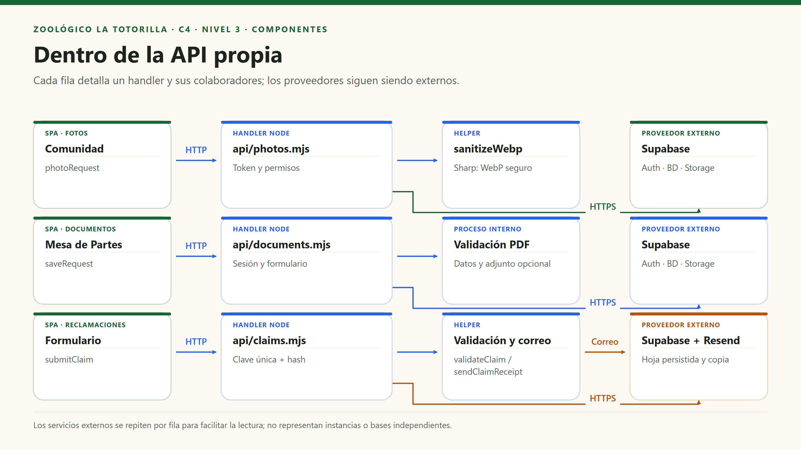

# C4 · Nivel 3 — Componentes de la API propia

[Índice general](../README.md) · [Anterior: contenedores](Nivel2-DiagramadeContenedores.md) · [Siguiente: código](Nivel4-DiagramadeCodigo.md)

## 1. Objetivo y contenedor ampliado

Esta vista abre la **API Node serverless propia** del nivel 2. Muestra sus handlers y helpers, sin mezclar las páginas React como si se ejecutaran dentro del servidor. La agrupación es lógica: Vercel puede invocar cada función en un entorno distinto.

| Aspecto | Descripción |
|---|---|
| Pregunta | ¿Qué componentes reciben las peticiones y qué colaboraciones necesitan? |
| Audiencia | Desarrollo, revisión de seguridad y arquitectura. |
| Contenedor detallado | API propia de La Totorilla. |
| Elementos externos al detalle | SPA, Supabase y Resend. |
| Nivel de componente | Módulos ESM y funciones agrupadas por propósito; no implica clases de negocio. |

## 2. Diagrama de componentes

Las flechas entre componentes propios son llamadas/imports en el entorno de la función; las flechas a proveedores son solicitudes remotas. No se inventa un módulo de Auth de backend compartido: cada handler protegido construye su cliente y verifica el token.

Cada fila muestra el servicio del navegador, el handler, su procesamiento y los proveedores externos. Supabase se repite por flujo para evitar cruces innecesarios; esas cajas representan el mismo proveedor, no bases independientes. Los handlers llaman directamente a los servicios gestionados; Sharp procesa la imagen localmente y el helper de correo se comunica con Resend. La validación PDF es un proceso del handler, no un nuevo módulo de servidor.

## 3. Componentes y contratos

| ID | Componente | Responsabilidad | Entradas / salidas | Código |
|---|---|---|---|---|
| CS01 | Fotos | Subir, solicitar retirada y ejecutar decisiones del personal. | WebP/query + token → JSON de resultado. | `api/photos.mjs`. |
| CS02 | Documentos | Validar datos/PDF, registrar recepción y permitir borrado autorizado. | Multipart/token o ID → código o error. | `api/documents.mjs`. |
| CS03 | Reclamaciones | Exponer disponibilidad, validar hoja, aplicar idempotencia y coordinar copia. | JSON sin sesión obligatoria → hoja o conflicto. | `api/claims.mjs`. |
| CS04 | Imágenes | Decodificar y regenerar WebP sin metadatos. | Buffer → datos procesados y dimensiones. | `server/photo-image.mjs`. |
| CS05 | Validación de reclamos | Normalizar campos, validar reglas y preparar entradas legibles. | Estructura de campos → valor/errores, correo o lista de entradas. | `shared/claims.mjs`. |
| CS06 | Correo | Construir contenido escapado, llamar Resend y actualizar aceptación. | Cliente DB + hoja → estado de copia. | `server/claim-mail.mjs`. |

## 4. Responsabilidades de datos

| Componente | Tablas / objetos | Operaciones | Restricción |
|---|---|---|---|
| Fotos | `visitor_photos`, membresía y bucket de fotos. | Reservar, cambiar estado, marcar solicitud y eliminar. | No permitir publicación por un visitante. |
| Documentos | `discount_requests`, membresía y bucket de PDF. | Reservar, confirmar recepción y eliminar. | Lectura privada a través de políticas; borrar solo con permiso del personal. |
| Reclamaciones | `consumer_claims`. | Insertar/recuperar por clave; datos originales no actualizables por la `service_role` actual. | La configuración legal debe estar lista; no se borra la hoja por fallo de correo. |
| Correo | Campos de copia en `consumer_claims`. | Actualizar aceptación y fecha cuando el proveedor acepta. | No reescribir contenido original de la hoja. |
| Trigger SQL | `private.daily_submissions`. | Incremento atómico al reservar fotos/documentos. | No es accesible al navegador ni depende de borrar fotos previas. |

Compartir `photo_admins` para autorización es deliberado. No se puede afirmar que cada módulo tenga su propia BD o que jamás lea una tabla común.

## 5. Componentes relacionados fuera del contenedor

| Componente del navegador | Relación con API | Otros accesos |
|---|---|---|
| Comunidad: hook y servicio | POST/PATCH de fotos. | Listado y URL firmadas vía Supabase. |
| Mesa de Partes: formulario y servicio | POST/DELETE de documentos. | Bandeja y descarga autorizada vía Supabase. |
| Reclamaciones: formulario y servicio | GET/POST de hojas. | Bandeja del personal vía Data API. |
| Tarifas | No utiliza un handler propio de tarifas. | CRUD de overrides mediante RLS. |
| Especies y mapa | No llaman a una API propia de especies. | Datos estáticos y archivos de `public/`. |

## 6. Fallos y controles del componente

| Situación | Respuesta / control |
|---|---|
| Método HTTP no soportado | 405 con `Allow`. |
| Sin configuración privada | 503; Fotos incluye nombres de variables faltantes, nunca sus valores. |
| Sesión ausente o inválida | 401 en fotos/documentos. |
| Permiso insuficiente | 403 en decisiones protegidas. |
| Archivo inválido o demasiado grande | 400/413/415 según el punto de rechazo. |
| Estado cambió durante revisión | 409 y ninguna decisión basada en el estado antiguo. |
| Clave de reclamo repetida con otros datos | 409; conserva hoja original. |
| Fallo externo no recuperable en la petición | Error controlado y estado persistido que debe revisarse. |

## 7. Componentes operativos, no peticiones web

`cleanup-photos.mjs` y `retry-claim-emails.mjs` son scripts externos al recorrido HTTP normal. La limpieza procesa lotes de reservas/fotos incompletas y el reintento consulta correos pendientes. No se asume scheduler, worker permanente ni envío de respuesta administrativa. El adaptador `vite-api.mjs` solo interviene en desarrollo.
