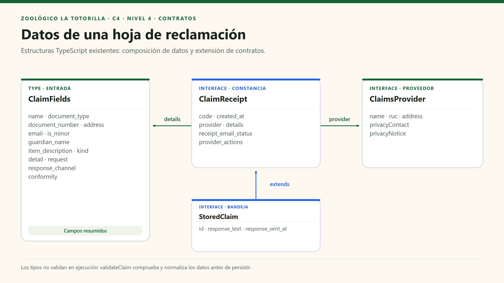
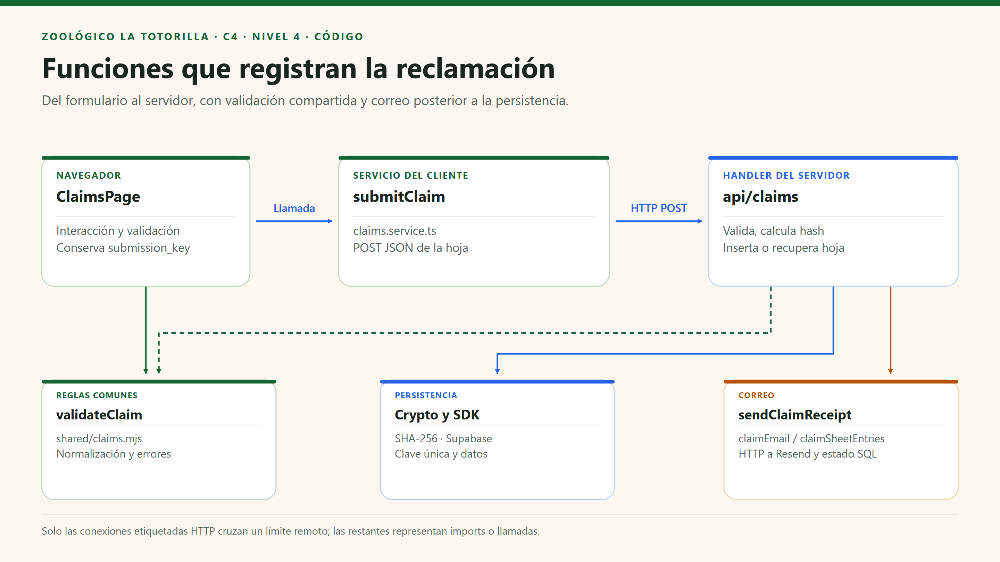
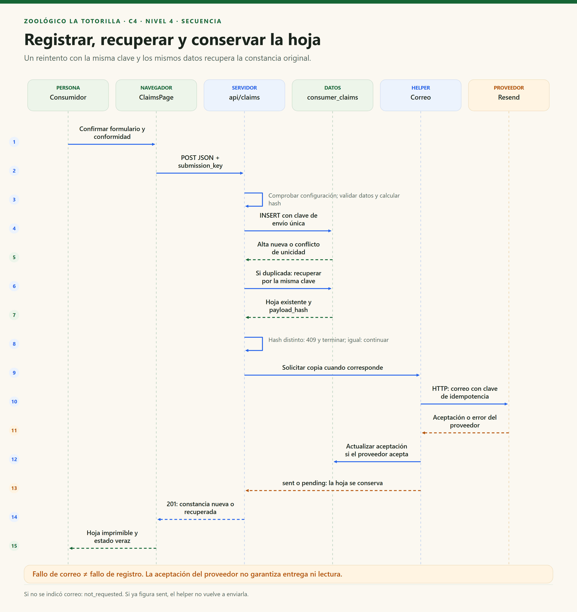

# C4 · Nivel 4 — Código y colaboraciones

[Índice general](../README.md) · [Anterior: componentes](Nivel3-Diagrama-de-Componentes.md) · [Diseño interno de Comunidad](../03-diseño-de-software/diseño-interno/diseño-interno-de-modulos.md)

> **Componente detallado:** Reclamaciones y correo de constancias. **Notación:** tipos UML simplificados y secuencia. **Alcance:** contratos y funciones existentes; no clases de dominio inventadas.

## 1. Objetivo

Mostrar cómo se conectan estructuras de datos, validador, servicio del navegador, handler HTTP y helper de correo. Se elige Reclamaciones porque la idempotencia y la conservación de evidencia necesitan una explicación más precisa que un dibujo de tres cajas.

| Aspecto | Descripción |
|---|---|
| Pregunta | ¿Qué tipos y funciones colaboran para registrar y recuperar una hoja? |
| Audiencia | Desarrolladores y revisores técnicos. |
| Tipos reales | `ClaimFields`, `ClaimsProvider`, `ClaimReceipt` y `StoredClaim`. |
| Funciones reales | `validateClaim`, `submitClaim`, `handler`, `sendClaimReceipt`. |
| Persistencia | `consumer_claims`, clave única de envío, hash y secuencia. |
| Qué no se representa | Una arquitectura de clases Controller/UseCase/Repository que no existe en el repositorio. |

## 2. Diagrama de estructuras de datos

`ClaimFields` se muestra resumido; el contrato completo está en `shared/claims.d.mts` y los valores/validaciones en `shared/claims.mjs`. Los tipos TypeScript desaparecen al compilar: **no son clases instanciadas ni validación automática en tiempo de ejecución**. Por eso la API ejecuta `validateClaim` antes de persistir.

### Notación

| Símbolo | Significado en esta vista | Límite |
|---|---|---|
| Caja `interface` / `type` | Estructura del contrato de datos. | No es una implementación orientada a objetos. |
| Flecha con nombre de campo | Un contrato contiene un dato con ese tipo. | No implica propiedad de infraestructura ni ciclo de vida independiente. |
| Flecha `extends` | `StoredClaim` amplía `ClaimReceipt`. | No representa herencia entre servicios o controladores. |

## 3. Funciones y archivos

| Unidad | Archivo real | Responsabilidad / firma resumida |
|---|---|---|
| `control` y `register` de la página | `src/pages/ClaimsPage.tsx`. | Construir campos, validar interacción y llamar al servicio con una clave de envío conservada. |
| `claimsSettings()` | `src/features/claims/claims.service.ts`. | Leer identificación del proveedor y disponibilidad. |
| `submitClaim(details, submissionKey)` | Mismo servicio. | POST JSON; transformar error/respuesta en resultado del formulario. |
| `validateClaim(input)` | `shared/claims.mjs`. | Normalizar y devolver `{ value, errors }`. |
| `handler(req, res)` | `api/claims.mjs`. | Validar HTTP/configuración, calcular hash, insertar/recuperar y coordinar copia. |
| `claimEmail(details)` | `shared/claims.mjs`. | Seleccionar correo del consumidor o representante. |
| `claimSheetEntries(details)` | Mismo módulo compartido. | Preparar etiquetas y valores para hoja/correo. |
| `sendClaimReceipt(db, claim)` | `server/claim-mail.mjs`. | Construir HTML escapado, pedir envío y registrar aceptación; devolver pendiente ante fallo. |
| `listClaims(page)` | Servicio del navegador. | Leer 50 hojas bajo permisos del personal. |

## 4. Dependencias de código

Solo las flechas marcadas HTTP cruzan un límite remoto. El resto son imports/llamadas. El navegador y servidor comparten reglas puras, no el cliente privilegiado ni una instancia del handler.

## 5. Secuencia: registrar una reclamación y reintentar

El diagrama resume el camino donde existe destinatario y la copia no estaba aceptada. Si no se indicó correo, el estado es `not_requested`; si ya figura `sent`, el helper no vuelve a enviarla. El conflicto de hash finaliza antes de correo/respuesta de éxito.

## 6. Reglas, errores y persistencia

| Regla / condición | Implementación | Efecto observable |
|---|---|---|
| El registro no exige sesión. | La API de reclamos no llama `getUser` ni requiere Bearer. | Un consumidor no necesita cuenta para reclamar. |
| Campos inválidos | `validateClaim` compartido más límites HTTP/SQL. | 400 con errores por campo. |
| Configuración incompleta | `settings().ready`. | 503 y ningún registro simulado. |
| Mismo envío y datos | Clave única y hash coincidente. | Se recupera la misma hoja, no otra nueva. |
| Misma clave con otros datos | Comparación SHA-256. | 409; no se sobreescribe evidencia original. |
| Fallo de correo | Captura controlada posterior al INSERT. | Hoja válida con copia pendiente. |
| Correo aceptado | Guardar estado/ID/fecha de aceptación. | `sent` no significa entrega ni lectura. |
| Numeración | Secuencia identity y código generado. | Puede haber saltos; nunca reiniciar para ocultarlos. |
| Consulta privada | `listClaims` con RLS y grants limitados. | Solo personal autorizado obtiene las hojas. |

## 7. Pruebas y limitaciones

| Prueba / revisión | Qué comprueba | Qué no comprueba |
|---|---|---|
| `server/claims.test.mjs` | Reglas compartidas y datos normalizados. | Configuración de proveedor real. |
| `server/claims-api.test.mjs` | Contratos y fallos del flujo mediante dobles de prueba. | Entrega al buzón y estado operacional completo. |
| `supabase/tests/security.sql` | Privacidad, clave única y permisos con fixtures reversibles. | Cumplimiento normativo integral o ataques no modelados. |
| Revisión de estilos de impresión | Hoja sin navegación/footer y filas protegidas de cortes según reglas. | Calidad en toda impresora o navegador. |

No hay clases `ClaimRepository`, `RegistrarReclamoUseCase` ni cola de correo en el código actual. Si se proponen después, deben presentarse como evolución, no como elementos ya implementados.
